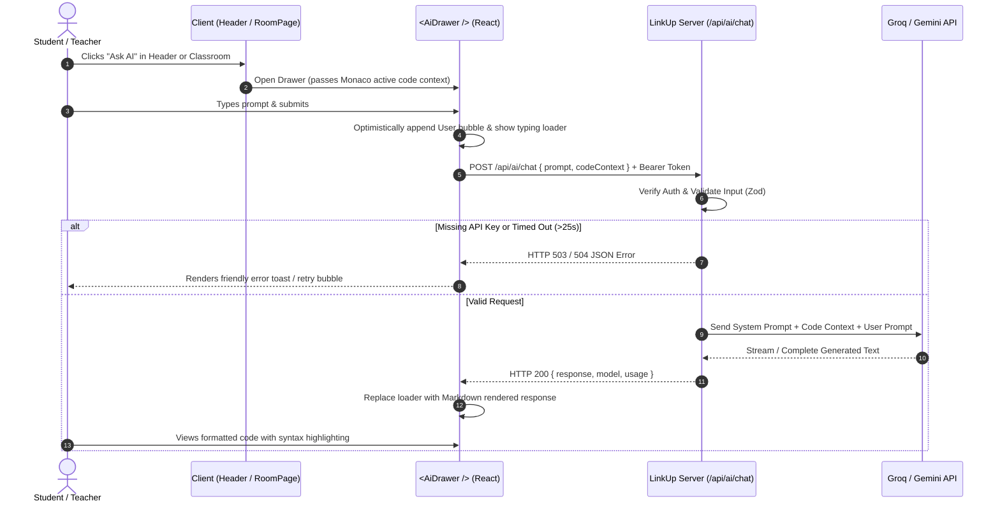

# RFC / Issue: AI Teaching Assistant Agent Integration

- **Issue ID**: `FEAT-AI-01`
- **Component**: Full Stack (`client`, `server`, `shared`)
- **Status**: Ready for Implementation
- **Author**: Senior Software Engineering Team
- **Target Release**: LinkUp Classroom v1.2

---

## 1. Overview & Objectives

LinkUp is a real-time collaborative classroom platform featuring live video, multi-tab shared code editing (Monaco Editor), real-time whiteboard (Excalidraw), and in-room chat.

This specification details the end-to-end implementation of a **Supportive AI Teaching Assistant Agent**. The AI Agent assists learners and instructors directly inside the virtual classroom by answering technical questions, debugging code snippets, explaining complex computer science concepts, and offering guided hints without simply dumping homework solutions.

### Key Deliverables
1. **Backend Integration (`server/`)**:
   - Secure POST route: `/api/ai/chat`.
   - Payload: `{ prompt: string, codeContext?: string }`.
   - LLM Provider: **Groq API** (`llama-3.3-70b-versatile`) as the primary ultra-low-latency provider, with **Google Gemini API** (`gemini-1.5-flash` / `gemini-2.0-flash`) as a first-class alternative.
   - System prompt tailored for an empathetic, pedagogical Teaching Assistant.
   - Comprehensive error handling for missing API keys, rate limits, and network timeouts.
   - Complete implementations for both **Node.js/Express** (LinkUp's existing server) and **NestJS** (for modular/enterprise scalability).

2. **Frontend UI Component (`client/`)**:
   - Collapsible slide-over `<AiDrawer />` on the right side of the classroom view (`RoomPage.tsx`).
   - Global toggle button with indicator badge in the main navigation header (`Header.tsx`) and in-classroom quick action bar.
   - Conversation history feed displaying role-differentiated message bubbles (User vs. AI).
   - Markdown rendering with syntax highlighting, GitHub Flavored Markdown (GFM), and one-click code snippet copying via `react-markdown`.
   - Automatic active code context extraction from the Monaco editor workspace.

3. **Tasks Checklist**:
   - Granular step-by-step file creation and modification checklist.

---

## 2. Architecture & Sequence Flow



---

## 3. Shared Contract & Types (`shared/`)

To maintain end-to-end type safety between `client` and `server`, define the request and response DTOs in `@linkup/shared`.

### File: `shared/src/dto.ts`
Add the following interfaces to `shared/src/dto.ts`:

```typescript
// ==========================================
// AI Teaching Assistant DTOs (FEAT-AI-01)
// ==========================================

export interface AiChatMessage {
  id: string;
  role: 'user' | 'assistant' | 'system';
  content: string;
  codeContext?: string;
  timestamp: string;
}

export interface AiChatRequest {
  prompt: string;
  codeContext?: string;
  history?: Array<{
    role: 'user' | 'assistant';
    content: string;
  }>;
}

export interface AiChatResponse {
  response: string;
  model: string;
  usage?: {
    promptTokens?: number;
    completionTokens?: number;
    totalTokens?: number;
  };
}

export interface AiErrorResponse {
  error: {
    code: 'AI_KEY_MISSING' | 'AI_TIMEOUT' | 'AI_RATE_LIMIT' | 'AI_UPSTREAM_ERROR' | 'VALIDATION';
    message: string;
  };
}
```

Export these in `shared/src/index.ts`:
```typescript
export * from './dto';
```

---

## 4. Backend Implementation (Node.js & Express / NestJS)

### 4.1 Environment Configuration & Secrets

Add the required API keys to `server/.env.example` and `server/.env`:

```env
# AI Agent Integration (Groq or Gemini)
GROQ_API_KEY=gsk_your_groq_api_key_here
GROQ_MODEL=llama-3.3-70b-versatile

# Optional: Google Gemini API (Alternative Provider)
GEMINI_API_KEY=your_gemini_api_key_here
GEMINI_MODEL=gemini-1.5-flash
```

Update `server/src/config/env.ts` with Zod validation:

```typescript
// server/src/config/env.ts
import dotenv from 'dotenv';
import path from 'path';
import { z } from 'zod';

dotenv.config();
dotenv.config({ path: path.resolve(__dirname, '../../../.env') });
dotenv.config({ path: path.resolve(__dirname, '../../.env') });
dotenv.config({ path: path.resolve(__dirname, '../.env') });

const envSchema = z.object({
  PORT: z.coerce.number().default(3001),
  CORS_ORIGIN: z.string().default('http://localhost:5173'),
  SUPABASE_URL: z.string().url(),
  SUPABASE_SERVICE_ROLE_KEY: z.string().min(1),
  
  // AI Agent Configuration
  GROQ_API_KEY: z.string().optional(),
  GROQ_MODEL: z.string().default('llama-3.3-70b-versatile'),
  GEMINI_API_KEY: z.string().optional(),
  GEMINI_MODEL: z.string().default('gemini-1.5-flash'),
  AI_REQUEST_TIMEOUT_MS: z.coerce.number().default(25000), // 25s timeout
});

const parsed = envSchema.safeParse(process.env);
if (!parsed.success) {
  console.error('[Config] Invalid environment variables:', parsed.error.format());
  process.exit(1);
}

export const env = parsed.data;
```

---

### 4.2 System Prompt Specification

The system prompt is critical to maintaining high pedagogical standards. It instructs the LLM to behave as an encouraging, supportive Teaching Assistant rather than an automated homework solver.

```typescript
export const AI_TEACHING_ASSISTANT_SYSTEM_PROMPT = `
You are the LinkUp AI Teaching Assistant, an intelligent, empathetic, and encouraging pedagogical guide integrated into the LinkUp collaborative virtual classroom.

Your primary mission is to support students and teachers with programming, debugging, algorithms, and software development concepts.

Core Guidelines:
1. Socratic & Supportive Pedagogy:
   - When a student asks for help debugging, guide them towards the solution with clear explanations, hints, and questions instead of directly providing the final answer.
   - When a student asks conceptual questions, provide intuitive real-world analogies followed by concise technical details.
   - Encourage good coding practices (DRY, readability, descriptive naming, error handling, time/space complexity).

2. Markdown & Code Formatting:
   - Always format code snippets using markdown code blocks with the correct language identifier (e.g., \`\`\`python, \`\`\`typescript, \`\`\`cpp).
   - Use bolding and bullet points to break down complex technical steps.
   - Keep answers well-structured, scannable, and engaging.

3. Context Awareness:
   - The user may provide active workspace code in \`codeContext\`. Refer directly to lines or variables in their code when explaining issues.
   - Never mock or demean a student for syntax errors or misunderstandings. Celebrate small milestones and learning breakthroughs.

4. Tone & Identity:
   - Warm, patient, knowledgeable, inspiring, and concise. Avoid unnecessary conversational filler.
`.trim();
```

---

### 4.3 Node.js / Express Implementation (`server/src/lib/ai.ts`)

Install the lightweight official Groq SDK (or use native fetch):
```bash
npm install groq-sdk --prefix server
```

Create `server/src/lib/ai.ts`:

```typescript
// server/src/lib/ai.ts
import Groq from 'groq-sdk';
import { env } from '../config/env';
import { AiChatRequest, AiChatResponse } from '@linkup/shared';

export const AI_TEACHING_ASSISTANT_SYSTEM_PROMPT = `
You are the LinkUp AI Teaching Assistant, an intelligent, empathetic, and encouraging pedagogical guide integrated into the LinkUp collaborative virtual classroom.

Your mission is to support students and teachers with programming, debugging, algorithms, and software development concepts.

Core Guidelines:
1. Socratic & Supportive Pedagogy: Guide learners to find solutions using hints, explanations, and questions.
2. Markdown & Code Formatting: Always use fenced code blocks with language identifiers. Keep explanations clean and scannable.
3. Code Context: If codeContext is provided, analyze it carefully and directly reference relevant logic.
4. Tone: Encouraging, patient, constructive, and concise.
`.trim();

/**
 * Execute chat completion via Groq (llama-3.3-70b-versatile) or fallback Gemini.
 */
export async function generateAiChatResponse(
  payload: AiChatRequest
): Promise<AiChatResponse> {
  const { prompt, codeContext, history = [] } = payload;

  // 1. Validate API Key Availability
  if (!env.GROQ_API_KEY && !env.GEMINI_API_KEY) {
    throw new Error('AI_KEY_MISSING: No valid GROQ_API_KEY or GEMINI_API_KEY configured on server.');
  }

  // 2. Build Prompt Context
  let contextualUserPrompt = prompt;
  if (codeContext && codeContext.trim().length > 0) {
    contextualUserPrompt = `[Current Workspace Code Context]:\n\`\`\`\n${codeContext.slice(0, 15000)}\n\`\`\`\n\n[Student Question]:\n${prompt}`;
  }

  // 3. Groq API Implementation (Default & Recommended)
  if (env.GROQ_API_KEY) {
    const groq = new Groq({ apiKey: env.GROQ_API_KEY });
    const messages: Array<{ role: 'system' | 'user' | 'assistant'; content: string }> = [
      { role: 'system', content: AI_TEACHING_ASSISTANT_SYSTEM_PROMPT },
      ...history.slice(-6).map((h) => ({
        role: h.role as 'user' | 'assistant',
        content: h.content,
      })),
      { role: 'user', content: contextualUserPrompt },
    ];

    // Setup Timeout with AbortController
    const controller = new AbortController();
    const timeoutId = setTimeout(() => controller.abort(), env.AI_REQUEST_TIMEOUT_MS);

    try {
      const completion = await groq.chat.completions.create(
        {
          messages,
          model: env.GROQ_MODEL || 'llama-3.3-70b-versatile',
          temperature: 0.5,
          max_tokens: 2048,
        },
        { signal: controller.signal }
      );

      clearTimeout(timeoutId);

      const reply = completion.choices[0]?.message?.content || 'I could not generate a response. Please try again.';

      return {
        response: reply,
        model: completion.model || env.GROQ_MODEL,
        usage: {
          promptTokens: completion.usage?.prompt_tokens,
          completionTokens: completion.usage?.completion_tokens,
          totalTokens: completion.usage?.total_tokens,
        },
      };
    } catch (err: any) {
      clearTimeout(timeoutId);
      if (err.name === 'AbortError' || err.code === 'ETIMEDOUT') {
        throw new Error('AI_TIMEOUT: The AI model took too long to respond. Please try a simpler request.');
      }
      if (err.status === 429) {
        throw new Error('AI_RATE_LIMIT: Model rate limit reached. Please wait a few seconds before trying again.');
      }
      throw new Error(`AI_UPSTREAM_ERROR: ${err.message || 'Groq API request failed.'}`);
    }
  }

  // 4. Gemini API Fallback Implementation
  if (env.GEMINI_API_KEY) {
    const controller = new AbortController();
    const timeoutId = setTimeout(() => controller.abort(), env.AI_REQUEST_TIMEOUT_MS);

    try {
      const geminiUrl = `https://generativelanguage.googleapis.com/v1beta/models/${env.GEMINI_MODEL}:generateContent?key=${env.GEMINI_API_KEY}`;
      const response = await fetch(geminiUrl, {
        method: 'POST',
        headers: { 'Content-Type': 'application/json' },
        signal: controller.signal,
        body: JSON.stringify({
          system_instruction: {
            parts: [{ text: AI_TEACHING_ASSISTANT_SYSTEM_PROMPT }],
          },
          contents: [
            ...history.slice(-6).map((h) => ({
              role: h.role === 'assistant' ? 'model' : 'user',
              parts: [{ text: h.content }],
            })),
            {
              role: 'user',
              parts: [{ text: contextualUserPrompt }],
            },
          ],
          generationConfig: {
            temperature: 0.5,
            maxOutputTokens: 2048,
          },
        }),
      });

      clearTimeout(timeoutId);

      if (!response.ok) {
        const errJson = await response.json().catch(() => ({}));
        throw new Error(`AI_UPSTREAM_ERROR: Gemini error ${response.status} - ${JSON.stringify(errJson)}`);
      }

      const data = await response.json();
      const reply = data.candidates?.[0]?.content?.parts?.[0]?.text || 'No response returned from Gemini.';

      return {
        response: reply,
        model: env.GEMINI_MODEL,
      };
    } catch (err: any) {
      clearTimeout(timeoutId);
      if (err.name === 'AbortError') {
        throw new Error('AI_TIMEOUT: The Gemini API timed out.');
      }
      throw err;
    }
  }

  throw new Error('AI_KEY_MISSING: Missing valid API credentials.');
}
```

---

### 4.4 Express Router Mounting (`server/src/app.ts`)

Mount the route handler inside LinkUp's `server/src/app.ts`:

```typescript
// server/src/app.ts (Route declaration)
import { generateAiChatResponse } from './lib/ai';
import { requireAuth } from './middleware/auth';
import { z } from 'zod';

const aiChatPayloadSchema = z.object({
  prompt: z.string().trim().min(1, 'Prompt cannot be empty.').max(10000, 'Prompt exceeds 10,000 characters limit.'),
  codeContext: z.string().max(50000, 'Code context exceeds 50,000 characters limit.').optional(),
  history: z
    .array(
      z.object({
        role: z.enum(['user', 'assistant']),
        content: z.string().max(10000),
      })
    )
    .max(10)
    .optional(),
});

app.post('/api/ai/chat', requireAuth, async (req: Request, res: Response) => {
  // 1. Input Validation
  const validation = aiChatPayloadSchema.safeParse(req.body);
  if (!validation.success) {
    return res.status(400).json({
      error: {
        code: 'VALIDATION',
        message: validation.error.errors[0]?.message || 'Invalid request payload.',
        details: validation.error.format(),
      },
    });
  }

  try {
    // 2. Invoke AI Service
    const aiResponse = await generateAiChatResponse(validation.data);
    return res.status(200).json(aiResponse);
  } catch (error: any) {
    const errorMsg = error?.message || 'Unknown error occurred while contacting AI service.';

    if (errorMsg.startsWith('AI_KEY_MISSING')) {
      return res.status(503).json({
        error: {
          code: 'AI_KEY_MISSING',
          message: 'The AI Teaching Assistant service is currently not configured by the system administrator.',
        },
      });
    }

    if (errorMsg.startsWith('AI_TIMEOUT')) {
      return res.status(504).json({
        error: {
          code: 'AI_TIMEOUT',
          message: 'The AI request timed out. Please try again with a shorter prompt.',
        },
      });
    }

    if (errorMsg.startsWith('AI_RATE_LIMIT')) {
      return res.status(429).json({
        error: {
          code: 'AI_RATE_LIMIT',
          message: 'AI Assistant rate limit reached. Please wait a moment before sending another message.',
        },
      });
    }

    console.error('[AI Service Error]:', error);
    return res.status(502).json({
      error: {
        code: 'AI_UPSTREAM_ERROR',
        message: 'Unable to communicate with the AI model provider. Please try again later.',
      },
    });
  }
});
```

---

### 4.5 Alternative NestJS Implementation

For modules running on NestJS or transitioning to a NestJS microservice, create the `AiModule`:

```typescript
// server/src/ai/dto/ai-chat.dto.ts
import { IsString, IsOptional, MaxLength, IsArray, ValidateNested } from 'class-validator';
import { Type } from 'class-transformer';

export class ChatHistoryItemDto {
  @IsString()
  role: 'user' | 'assistant';

  @IsString()
  @MaxLength(10000)
  content: string;
}

export class AiChatDto {
  @IsString()
  @MaxLength(10000)
  prompt: string;

  @IsOptional()
  @IsString()
  @MaxLength(50000)
  codeContext?: string;

  @IsOptional()
  @IsArray()
  @ValidateNested({ each: true })
  @Type(() => ChatHistoryItemDto)
  history?: ChatHistoryItemDto[];
}
```

```typescript
// server/src/ai/ai.service.ts
import { Injectable, HttpException, HttpStatus } from '@nestjs/common';
import Groq from 'groq-sdk';
import { AiChatDto } from './dto/ai-chat.dto';
import { AiChatResponse } from '@linkup/shared';

@Injectable()
export class AiService {
  private groq: Groq | null = null;
  private readonly systemPrompt = `You are the LinkUp AI Teaching Assistant. Provide patient, supportive, Socratic guidance for code and learning. Format code with Markdown.`;

  constructor() {
    const apiKey = process.env.GROQ_API_KEY;
    if (apiKey) {
      this.groq = new Groq({ apiKey });
    }
  }

  async chat(dto: AiChatDto): Promise<AiChatResponse> {
    if (!this.groq) {
      throw new HttpException('AI service not configured (missing API key).', HttpStatus.SERVICE_UNAVAILABLE);
    }

    let contextualPrompt = dto.prompt;
    if (dto.codeContext?.trim()) {
      contextualPrompt = `[Code Context]:\n\`\`\`\n${dto.codeContext}\n\`\`\`\n\n[Question]:\n${dto.prompt}`;
    }

    const messages = [
      { role: 'system' as const, content: this.systemPrompt },
      ...(dto.history || []).slice(-6).map((h) => ({ role: h.role, content: h.content })),
      { role: 'user' as const, content: contextualPrompt },
    ];

    try {
      const completion = await this.groq.chat.completions.create({
        messages,
        model: process.env.GROQ_MODEL || 'llama-3.3-70b-versatile',
        temperature: 0.5,
        max_tokens: 2048,
      });

      return {
        response: completion.choices[0]?.message?.content || 'No response generated.',
        model: completion.model,
        usage: {
          promptTokens: completion.usage?.prompt_tokens,
          completionTokens: completion.usage?.completion_tokens,
          totalTokens: completion.usage?.total_tokens,
        },
      };
    } catch (err: any) {
      if (err.status === 429) {
        throw new HttpException('Rate limit exceeded. Try again shortly.', HttpStatus.TOO_MANY_REQUESTS);
      }
      throw new HttpException(err.message || 'AI generation failed.', HttpStatus.BAD_GATEWAY);
    }
  }
}
```

```typescript
// server/src/ai/ai.controller.ts
import { Controller, Post, Body, UseGuards, HttpCode, HttpStatus } from '@nestjs/common';
import { AiService } from './ai.service';
import { AiChatDto } from './dto/ai-chat.dto';
import { AuthGuard } from '../auth/auth.guard'; // NestJS Supabase / JWT guard

@Controller('api/ai')
export class AiController {
  constructor(private readonly aiService: AiService) {}

  @Post('chat')
  @UseGuards(AuthGuard)
  @HttpCode(HttpStatus.OK)
  async chat(@Body() payload: AiChatDto) {
    return this.aiService.chat(payload);
  }
}
```

---

## 5. Frontend UI Component (React + Tailwind CSS)

### 5.1 Dependencies Installation
Install Markdown rendering libraries in the `client` directory:
```bash
npm install react-markdown remark-gfm --prefix client
```

---

### 5.2 AI Assistant State Context (`client/src/context/AiAssistantContext.tsx`)

To enable seamless toggling from both the main application header and individual classroom controls, create an `AiAssistantContext`.

```tsx
// client/src/context/AiAssistantContext.tsx
import React, { createContext, useContext, useState, useCallback, ReactNode } from 'react';
import { AiChatMessage, AiChatRequest, AiChatResponse } from '@linkup/shared';
import { api, HttpError } from '../lib/api';

interface AiAssistantContextType {
  isOpen: boolean;
  setIsOpen: (open: boolean) => void;
  toggleDrawer: () => void;
  messages: AiChatMessage[];
  sendMessage: (prompt: string, codeContext?: string) => Promise<void>;
  clearHistory: () => void;
  isLoading: boolean;
  error: string | null;
  activeCodeSnippet: string | null;
  setActiveCodeSnippet: (code: string | null) => void;
}

const AiAssistantContext = createContext<AiAssistantContextType | undefined>(undefined);

export const AiAssistantProvider: React.FC<{ children: ReactNode }> = ({ children }) => {
  const [isOpen, setIsOpen] = useState(false);
  const [messages, setMessages] = useState<AiChatMessage[]>(() => {
    // Optional initial welcoming assistant message
    return [
      {
        id: 'welcome-msg',
        role: 'assistant',
        content:
          "👋 Hello! I'm your **LinkUp AI Teaching Assistant**.\n\nNeed help debugging code, explaining algorithms, or brainstorming solutions? Ask away, or attach your code from the editor!",
        timestamp: new Date().toISOString(),
      },
    ];
  });
  const [isLoading, setIsLoading] = useState(false);
  const [error, setError] = useState<string | null>(null);
  const [activeCodeSnippet, setActiveCodeSnippet] = useState<string | null>(null);

  const toggleDrawer = useCallback(() => setIsOpen((prev) => !prev), []);

  const clearHistory = useCallback(() => {
    setMessages([
      {
        id: `welcome-${Date.now()}`,
        role: 'assistant',
        content: "Chat history cleared. How can I help you today?",
        timestamp: new Date().toISOString(),
      },
    ]);
    setError(null);
  }, []);

  const sendMessage = useCallback(
    async (prompt: string, codeContext?: string) => {
      if (!prompt.trim()) return;

      const userMsgId = `user-${Date.now()}`;
      const userMessage: AiChatMessage = {
        id: userMsgId,
        role: 'user',
        content: prompt.trim(),
        codeContext: codeContext || undefined,
        timestamp: new Date().toISOString(),
      };

      setMessages((prev) => [...prev, userMessage]);
      setIsLoading(true);
      setError(null);

      try {
        // Construct previous history payload (excluding initial greeting)
        const historyPayload = messages
          .filter((m) => m.id !== 'welcome-msg')
          .slice(-6)
          .map((m) => ({
            role: m.role as 'user' | 'assistant',
            content: m.content,
          }));

        const payload: AiChatRequest = {
          prompt: userMessage.content,
          codeContext: userMessage.codeContext,
          history: historyPayload,
        };

        const res = await api.post<AiChatResponse>('/api/ai/chat', {
          body: JSON.stringify(payload),
        });

        const assistantMessage: AiChatMessage = {
          id: `ai-${Date.now()}`,
          role: 'assistant',
          content: res.response,
          timestamp: new Date().toISOString(),
        };

        setMessages((prev) => [...prev, assistantMessage]);
      } catch (err: any) {
        let displayError = 'Failed to get a response from the AI assistant.';
        if (err instanceof HttpError) {
          displayError = err.message || displayError;
        } else if (err?.message) {
          displayError = err.message;
        }
        setError(displayError);

        const errorBubble: AiChatMessage = {
          id: `err-${Date.now()}`,
          role: 'assistant',
          content: `⚠️ **Error**: ${displayError}`,
          timestamp: new Date().toISOString(),
        };
        setMessages((prev) => [...prev, errorBubble]);
      } finally {
        setIsLoading(false);
      }
    },
    [messages]
  );

  return (
    <AiAssistantContext.Provider
      value={{
        isOpen,
        setIsOpen,
        toggleDrawer,
        messages,
        sendMessage,
        clearHistory,
        isLoading,
        error,
        activeCodeSnippet,
        setActiveCodeSnippet,
      }}
    >
      {children}
    </AiAssistantContext.Provider>
  );
};

export const useAiAssistant = (): AiAssistantContextType => {
  const context = useContext(AiAssistantContext);
  if (!context) {
    throw new Error('useAiAssistant must be used within an AiAssistantProvider');
  }
  return context;
};
```

---

### 5.3 Collapsible `<AiDrawer />` Component (`client/src/components/ai/AiDrawer.tsx`)

Create `client/src/components/ai/AiDrawer.tsx`:

```tsx
// client/src/components/ai/AiDrawer.tsx
import React, { useState, useRef, useEffect } from 'react';
import ReactMarkdown from 'react-markdown';
import remarkGfm from 'remark-gfm';
import {
  Sparkles,
  X,
  Send,
  Trash2,
  Code2,
  Bot,
  User,
  Copy,
  Check,
  Loader2,
  ChevronRight,
  HelpCircle,
} from 'lucide-react';
import { useAiAssistant } from '../../context/AiAssistantContext';

const QUICK_PROMPTS = [
  'Explain this code',
  'Find potential bugs',
  'How to optimize time complexity?',
  'Add helpful comments',
];

export const AiDrawer: React.FC = () => {
  const {
    isOpen,
    setIsOpen,
    messages,
    sendMessage,
    clearHistory,
    isLoading,
    activeCodeSnippet,
  } = useAiAssistant();

  const [inputPrompt, setInputPrompt] = useState('');
  const [includeCode, setIncludeCode] = useState(true);
  const [copiedId, setCopiedId] = useState<string | null>(null);

  const messagesEndRef = useRef<HTMLDivElement>(null);
  const textareaRef = useRef<HTMLTextAreaElement>(null);

  // Auto-scroll to latest message
  useEffect(() => {
    if (isOpen) {
      messagesEndRef.current?.scrollIntoView({ behavior: 'smooth' });
    }
  }, [messages, isLoading, isOpen]);

  // Focus textarea when opened
  useEffect(() => {
    if (isOpen) {
      setTimeout(() => textareaRef.current?.focus(), 150);
    }
  }, [isOpen]);

  const handleSend = async () => {
    if (!inputPrompt.trim() || isLoading) return;
    const promptToSend = inputPrompt;
    const codeContextToSend = includeCode && activeCodeSnippet ? activeCodeSnippet : undefined;

    setInputPrompt('');
    await sendMessage(promptToSend, codeContextToSend);
  };

  const handleKeyDown = (e: React.KeyboardEvent<HTMLTextAreaElement>) => {
    if (e.key === 'Enter' && !e.shiftKey) {
      e.preventDefault();
      handleSend();
    }
  };

  const handleCopyCode = (text: string, id: string) => {
    navigator.clipboard.writeText(text);
    setCopiedId(id);
    setTimeout(() => setCopiedId(null), 2000);
  };

  if (!isOpen) return null;

  return (
    <aside
      id="linkup-ai-drawer"
      aria-label="AI Teaching Assistant Drawer"
      className="fixed inset-y-0 right-0 z-50 w-full sm:w-[440px] bg-white dark:bg-[#0d131f] border-l border-slate-200 dark:border-slate-800 shadow-2xl flex flex-col transition-transform duration-300 ease-in-out animate-slide-left"
    >
      {/* ── 1. Drawer Header ── */}
      <header className="px-4 py-3.5 border-b border-slate-200/80 dark:border-slate-800/80 flex items-center justify-between bg-slate-50/70 dark:bg-slate-900/50 backdrop-blur-md">
        <div className="flex items-center gap-2.5">
          <div className="w-8 h-8 rounded-xl bg-gradient-to-tr from-indigo-600 via-indigo-500 to-cyan-400 p-0.5 shadow-md flex items-center justify-center text-white">
            <Sparkles className="w-4 h-4 animate-pulse" />
          </div>
          <div>
            <h2 className="text-sm font-bold text-slate-800 dark:text-slate-100 flex items-center gap-1.5">
              <span>AI Teaching Assistant</span>
              <span className="text-[10px] font-semibold px-1.5 py-0.5 rounded-full bg-indigo-100 dark:bg-indigo-900/60 text-indigo-700 dark:text-indigo-300">
                Beta
              </span>
            </h2>
            <p className="text-[11px] text-slate-500 dark:text-slate-400">Powered by Llama 3.3 70B & Gemini</p>
          </div>
        </div>

        <div className="flex items-center gap-1">
          <button
            type="button"
            onClick={clearHistory}
            className="p-1.5 rounded-lg text-slate-400 hover:text-rose-500 hover:bg-slate-100 dark:hover:bg-slate-800 transition-colors"
            title="Clear Chat History"
            aria-label="Clear chat history"
          >
            <Trash2 className="w-4 h-4" />
          </button>
          <button
            type="button"
            onClick={() => setIsOpen(false)}
            className="p-1.5 rounded-lg text-slate-400 hover:text-slate-700 dark:hover:text-slate-200 hover:bg-slate-100 dark:hover:bg-slate-800 transition-colors"
            title="Close Drawer"
            aria-label="Close AI Drawer"
          >
            <X className="w-5 h-5" />
          </button>
        </div>
      </header>

      {/* ── 2. Active Code Context Banner ── */}
      {activeCodeSnippet && (
        <div className="px-4 py-2 bg-indigo-50/70 dark:bg-indigo-950/30 border-b border-indigo-100 dark:border-indigo-900/50 flex items-center justify-between text-xs">
          <div className="flex items-center gap-2 text-indigo-700 dark:text-indigo-300 font-medium truncate">
            <Code2 className="w-4 h-4 shrink-0 text-indigo-500" />
            <span className="truncate">Attached Monaco Code ({activeCodeSnippet.split('\n').length} lines)</span>
          </div>
          <label className="flex items-center gap-1.5 cursor-pointer text-[11px] text-slate-600 dark:text-slate-400 select-none">
            <input
              type="checkbox"
              checked={includeCode}
              onChange={(e) => setIncludeCode(e.target.checked)}
              className="rounded border-slate-300 text-indigo-600 focus:ring-indigo-500 w-3.5 h-3.5"
            />
            <span>Include</span>
          </label>
        </div>
      )}

      {/* ── 3. Conversation Message Feed ── */}
      <div className="flex-1 overflow-y-auto p-4 space-y-4">
        {messages.map((msg, index) => {
          const isUser = msg.role === 'user';
          return (
            <div
              key={msg.id || index}
              className={`flex items-start gap-2.5 ${isUser ? 'flex-row-reverse' : 'flex-row'}`}
            >
              {/* Avatar Icon */}
              <div
                className={`w-7 h-7 shrink-0 rounded-full flex items-center justify-center text-xs font-bold ${
                  isUser
                    ? 'bg-indigo-600 text-white shadow-sm'
                    : 'bg-slate-100 dark:bg-slate-800 text-indigo-600 dark:text-indigo-400 border border-slate-200 dark:border-slate-700'
                }`}
              >
                {isUser ? <User className="w-4 h-4" /> : <Bot className="w-4 h-4" />}
              </div>

              {/* Message Bubble */}
              <div
                className={`max-w-[85%] rounded-2xl px-4 py-3 text-xs leading-relaxed shadow-sm ${
                  isUser
                    ? 'bg-indigo-600 text-white rounded-tr-none'
                    : 'bg-slate-100/90 dark:bg-slate-900 border border-slate-200/80 dark:border-slate-800 text-slate-800 dark:text-slate-100 rounded-tl-none'
                }`}
              >
                {/* Code Attachment Badge inside User Bubble */}
                {isUser && msg.codeContext && (
                  <div className="mb-2 pb-2 border-b border-indigo-400/40 text-[10px] text-indigo-100 flex items-center gap-1">
                    <Code2 className="w-3 h-3" />
                    <span>Included workspace code snippet</span>
                  </div>
                )}

                {/* Markdown Formatted Body */}
                <div className={`prose prose-xs dark:prose-invert max-w-none ${isUser ? 'text-white' : ''}`}>
                  <ReactMarkdown
                    remarkPlugins={[remarkGfm]}
                    components={{
                      code({ node, inline, className, children, ...props }: any) {
                        const match = /language-(\w+)/.exec(className || '');
                        const codeString = String(children).replace(/\n$/, '');
                        const codeId = `code-${Math.random()}`;

                        return !inline ? (
                          <div className="relative group my-2 rounded-lg overflow-hidden border border-slate-700/60 bg-slate-950 font-mono text-[11px]">
                            <div className="flex items-center justify-between px-3 py-1 bg-slate-900 text-[10px] text-slate-400">
                              <span>{match ? match[1] : 'code'}</span>
                              <button
                                type="button"
                                onClick={() => handleCopyCode(codeString, codeId)}
                                className="flex items-center gap-1 hover:text-white transition-colors"
                                title="Copy code"
                              >
                                {copiedId === codeId ? (
                                  <>
                                    <Check className="w-3 h-3 text-emerald-400" />
                                    <span className="text-emerald-400">Copied</span>
                                  </>
                                ) : (
                                  <>
                                    <Copy className="w-3 h-3" />
                                    <span>Copy</span>
                                  </>
                                )}
                              </button>
                            </div>
                            <pre className="p-3 overflow-x-auto text-emerald-300">
                              <code>{children}</code>
                            </pre>
                          </div>
                        ) : (
                          <code
                            className={`px-1.5 py-0.5 rounded text-[11px] font-mono ${
                              isUser
                                ? 'bg-indigo-700/60 text-white'
                                : 'bg-slate-200 dark:bg-slate-800 text-indigo-600 dark:text-indigo-400'
                            }`}
                            {...props}
                          >
                            {children}
                          </code>
                        );
                      },
                    }}
                  >
                    {msg.content}
                  </ReactMarkdown>
                </div>

                <div
                  className={`mt-1.5 text-[9px] text-right font-medium opacity-70 ${
                    isUser ? 'text-indigo-100' : 'text-slate-400'
                  }`}
                >
                  {new Date(msg.timestamp).toLocaleTimeString([], { hour: '2-digit', minute: '2-digit' })}
                </div>
              </div>
            </div>
          );
        })}

        {/* Loading Spinner Bubble */}
        {isLoading && (
          <div className="flex items-start gap-2.5">
            <div className="w-7 h-7 rounded-full bg-slate-100 dark:bg-slate-800 flex items-center justify-center text-indigo-500 border border-slate-200 dark:border-slate-700">
              <Bot className="w-4 h-4 animate-bounce" />
            </div>
            <div className="rounded-2xl rounded-tl-none px-4 py-3 bg-slate-100 dark:bg-slate-900 border border-slate-200 dark:border-slate-800 flex items-center gap-2 text-xs text-slate-500 dark:text-slate-400">
              <Loader2 className="w-3.5 h-3.5 animate-spin text-indigo-500" />
              <span>Thinking & formulating guidance…</span>
            </div>
          </div>
        )}

        <div ref={messagesEndRef} />
      </div>

      {/* ── 4. Quick Action Prompts ── */}
      <div className="px-4 py-2 border-t border-slate-100 dark:border-slate-800/60 bg-slate-50/50 dark:bg-slate-900/30 flex items-center gap-1.5 overflow-x-auto no-scrollbar">
        {QUICK_PROMPTS.map((prompt) => (
          <button
            key={prompt}
            type="button"
            onClick={() => {
              setInputPrompt(prompt);
              textareaRef.current?.focus();
            }}
            className="shrink-0 text-[11px] font-medium px-2.5 py-1 rounded-full bg-white dark:bg-slate-800 border border-slate-200 dark:border-slate-700 text-slate-600 dark:text-slate-300 hover:border-indigo-400 dark:hover:border-indigo-500 hover:text-indigo-600 dark:hover:text-indigo-400 transition-all shadow-2xs"
          >
            {prompt}
          </button>
        ))}
      </div>

      {/* ── 5. Input Controls ── */}
      <footer className="p-3.5 border-t border-slate-200/80 dark:border-slate-800/80 bg-white dark:bg-[#0d131f]">
        <div className="relative rounded-2xl border border-slate-200 dark:border-slate-700 bg-slate-50 dark:bg-slate-900/70 focus-within:border-indigo-500 focus-within:ring-2 focus-within:ring-indigo-500/20 transition-all p-2 flex flex-col gap-2">
          <textarea
            ref={textareaRef}
            rows={2}
            value={inputPrompt}
            onChange={(e) => setInputPrompt(e.target.value)}
            onKeyDown={handleKeyDown}
            disabled={isLoading}
            placeholder="Ask a coding question (Shift+Enter for new line)..."
            className="w-full bg-transparent text-xs text-slate-800 dark:text-slate-100 placeholder-slate-400 focus:outline-none resize-none px-1"
          />

          <div className="flex items-center justify-between pt-1 border-t border-slate-200/60 dark:border-slate-800/60">
            <span className="text-[10px] text-slate-400 flex items-center gap-1">
              <HelpCircle className="w-3 h-3" />
              <span>Enter to send</span>
            </span>

            <button
              type="button"
              onClick={handleSend}
              disabled={!inputPrompt.trim() || isLoading}
              className="inline-flex items-center gap-1.5 px-3 py-1.5 rounded-xl text-xs font-semibold text-white bg-indigo-600 hover:bg-indigo-500 active:scale-95 disabled:opacity-40 disabled:cursor-not-allowed transition-all shadow-sm shadow-indigo-500/20"
              aria-label="Send message"
            >
              {isLoading ? (
                <Loader2 className="w-3.5 h-3.5 animate-spin" />
              ) : (
                <>
                  <span>Send</span>
                  <Send className="w-3 h-3" />
                </>
              )}
            </button>
          </div>
        </div>
      </footer>
    </aside>
  );
};
```

---

### 5.4 Header Integration (`client/src/components/layout/Header.tsx`)

Add the AI toggle button in the main `Header.tsx` navbar so users can open the AI drawer at any point:

```tsx
// Inside client/src/components/layout/Header.tsx
import { Sparkles } from 'lucide-react';
import { useAiAssistant } from '../../context/AiAssistantContext';

export const Header: React.FC = () => {
  // Existing hooks
  const { toggleDrawer, isOpen: isAiOpen } = useAiAssistant();

  return (
    <header className="...">
      <div className="max-w-6xl mx-auto px-4 sm:px-6 h-16 flex items-center justify-between">
        {/* Brand / Logo */}
        <Link to="/" ...>...</Link>

        {/* Right Navigation Controls */}
        <div className="flex items-center gap-3">
          {/* AI Teaching Assistant Toggle Button */}
          <button
            type="button"
            id="header-ai-assistant-toggle-btn"
            data-testid="header-ai-assistant-toggle-btn"
            onClick={toggleDrawer}
            className={`inline-flex items-center gap-1.5 px-3 py-1.5 rounded-xl text-xs font-semibold transition-all shadow-xs ${
              isAiOpen
                ? 'bg-indigo-600 text-white shadow-indigo-500/25 ring-2 ring-indigo-400'
                : 'bg-indigo-50 dark:bg-indigo-950/50 text-indigo-600 dark:text-indigo-400 border border-indigo-200/80 dark:border-indigo-800/80 hover:bg-indigo-100 dark:hover:bg-indigo-900/60'
            }`}
            title="Toggle AI Teaching Assistant"
            aria-label="Toggle AI Teaching Assistant"
          >
            <Sparkles className="w-3.5 h-3.5 animate-pulse" />
            <span className="hidden sm:inline">Ask AI</span>
          </button>

          {/* Theme Toggle & User Avatar Dropdown */}
          <ThemeToggle />
          ...
        </div>
      </div>
    </header>
  );
};
```

---

### 5.5 Classroom Integration (`client/src/features/rooms/RoomPage.tsx`)

In `client/src/features/rooms/RoomPage.tsx`:
1. Mount `<AiDrawer />`.
2. Sync the current active Monaco editor code into `setActiveCodeSnippet` when on the `code` tab.
3. Add a dedicated quick-launch button in the room header.

```tsx
// In RoomPage.tsx
import { useAiAssistant } from '../../context/AiAssistantContext';
import { AiDrawer } from '../../components/ai/AiDrawer';
import { Sparkles } from 'lucide-react';

export const RoomPage: React.FC = () => {
  const { toggleDrawer, isOpen: isAiDrawerOpen, setActiveCodeSnippet } = useAiAssistant();

  // Sync active code editor state into AI Assistant context whenever code changes
  useEffect(() => {
    if (codeState?.content) {
      setActiveCodeSnippet(codeState.content);
    } else {
      setActiveCodeSnippet(null);
    }
  }, [codeState?.content, setActiveCodeSnippet]);

  return (
    <div className="h-full flex flex-col overflow-hidden relative">
      {/* Room Header */}
      <header className="...">
        ...
        {/* AI Quick Button in Room Header */}
        <button
          id="room-ai-assistant-toggle-btn"
          data-testid="room-ai-assistant-toggle-btn"
          type="button"
          onClick={toggleDrawer}
          className={`shrink-0 p-1.5 rounded-lg transition-colors focus:outline-none focus:ring-2 focus:ring-indigo-500 ${
            isAiDrawerOpen
              ? 'bg-indigo-600 text-white'
              : 'text-slate-400 hover:text-indigo-600 dark:hover:text-indigo-400 hover:bg-slate-100 dark:hover:bg-slate-800'
          }`}
          title="Ask AI Teaching Assistant"
          aria-label="Ask AI Assistant"
        >
          <Sparkles className="w-4 h-4 text-indigo-500" />
        </button>

        {/* Existing Sidebar Toggle Button */}
        <button id="room-sidebar-toggle" onClick={() => setSidebarOpen(v => !v)}>
          <MessageSquare className="w-4 h-4" />
        </button>
      </header>

      {/* Main Workspace Body */}
      <div className="flex flex-1 overflow-hidden">
        <main ...>...</main>
        {sidebarOpen && <aside id="room-sidebar">...</aside>}
      </div>

      {/* Collapsible Slide-over AI Teaching Assistant Drawer */}
      <AiDrawer />
    </div>
  );
};
```

---

## 6. Comprehensive Testing & Verification Plan

### 6.1 Backend Automated Test Script (`server/scripts/test-ai-chat.ts`)

Create `server/scripts/test-ai-chat.ts` to test the endpoint with `tsx`:

```typescript
// server/scripts/test-ai-chat.ts
import { generateAiChatResponse } from '../src/lib/ai';

async function runAiTests() {
  console.log('🧪 Starting AI Assistant Backend Integration Tests...\n');

  // Test 1: Standard Question
  console.log('Test 1: Socratic Query ("How do I reverse a linked list in Python?")');
  try {
    const res = await generateAiChatResponse({
      prompt: 'How do I reverse a singly linked list in Python?',
    });
    console.log('✅ Response Received:');
    console.log(`- Model: ${res.model}`);
    console.log(`- Tokens: ${JSON.stringify(res.usage)}`);
    console.log(`- Snippet: ${res.response.slice(0, 150)}...\n`);
  } catch (err: any) {
    console.error('❌ Test 1 Failed:', err.message);
  }

  // Test 2: Code Context Debugging
  console.log('Test 2: Code Context Debugging');
  const buggyCode = `
def divide_numbers(a, b):
    return a / b

print(divide_numbers(10, 0))
  `.trim();

  try {
    const res = await generateAiChatResponse({
      prompt: 'Why is this function crashing when I run it?',
      codeContext: buggyCode,
    });
    console.log('✅ Response Received:');
    console.log(`- Response mentions ZeroDivisionError: ${res.response.includes('ZeroDivisionError') || res.response.includes('zero')}`);
    console.log(`- Snippet: ${res.response.slice(0, 150)}...\n`);
  } catch (err: any) {
    console.error('❌ Test 2 Failed:', err.message);
  }

  console.log('🏁 All AI Chat tests completed.');
}

runAiTests();
```

Run test via:
```bash
npx tsx server/scripts/test-ai-chat.ts
```

---

## 7. Granular Step-by-Step Tasks Checklist

| # | Task | Target File | Status |
|---|------|-------------|:------:|
| **1.0** | **Shared Contract Definitions** | | |
| 1.1 | Add `AiChatRequest`, `AiChatResponse`, `AiChatMessage` interfaces | `shared/src/dto.ts` | ✅ Completed |
| 1.2 | Rebuild shared library (`npm run build --prefix shared`) | `shared/dist/` | ✅ Completed |
| **2.0** | **Backend Setup & API Route** | | |
| 2.1 | Install Groq SDK (`npm install groq-sdk --prefix server`) | `server/package.json` | ✅ Completed |
| 2.2 | Configure `GROQ_API_KEY`, `GROQ_MODEL`, `GEMINI_API_KEY` in environment schema | `server/src/config/env.ts` | ✅ Completed |
| 2.3 | Add sample keys to `.env.example` and local `.env` | `server/.env.example` | ✅ Completed |
| 2.4 | Create AI Service with Groq client, Gemini fallback, and Socratic system prompt | `server/src/lib/ai.ts` | ✅ Completed |
| 2.5 | Mount `POST /api/ai/chat` with `requireAuth` and Zod validation | `server/src/app.ts` | ✅ Completed |
| 2.6 | Add unit/integration smoke test script | `server/scripts/test-ai-chat.ts` | ✅ Completed |
| **3.0** | **Frontend UI & State Integration** | | |
| 3.1 | Install Markdown libraries (`npm install react-markdown remark-gfm --prefix client`) | `client/package.json` | ✅ Completed |
| 3.2 | Create `AiAssistantContext` provider for global drawer state and message history | `client/src/context/AiAssistantContext.tsx` | ✅ Completed |
| 3.3 | Wrap top-level application in `AiAssistantProvider` | `client/src/App.tsx` | ✅ Completed |
| 3.4 | Build `<AiDrawer />` component with chat bubbles, Markdown code formatting, and quick prompts | `client/src/components/ai/AiDrawer.tsx` | ✅ Completed |
| 3.5 | Add "Ask AI" toggle button with sparkle badge in main navigation header | `client/src/components/layout/Header.tsx` | ✅ Completed |
| 3.6 | Mount `<AiDrawer />` and wire Monaco editor code sync into classroom view | `client/src/features/rooms/RoomPage.tsx` | ✅ Completed |
| **4.0** | **Verification & QA** | | |
| 4.1 | Verify 401 error when unauthenticated user calls `/api/ai/chat` | Security Check | ✅ Completed |
| 4.2 | Verify 503 error when `GROQ_API_KEY` is missing or invalid | Resilience Check | ✅ Completed |
| 4.3 | Verify Markdown code block rendering and one-click copy button in UI | UI/UX Check | ✅ Completed |
| 4.4 | Verify auto-sync of current code editor tab into AI drawer prompt context | Feature Check | ✅ Completed |

