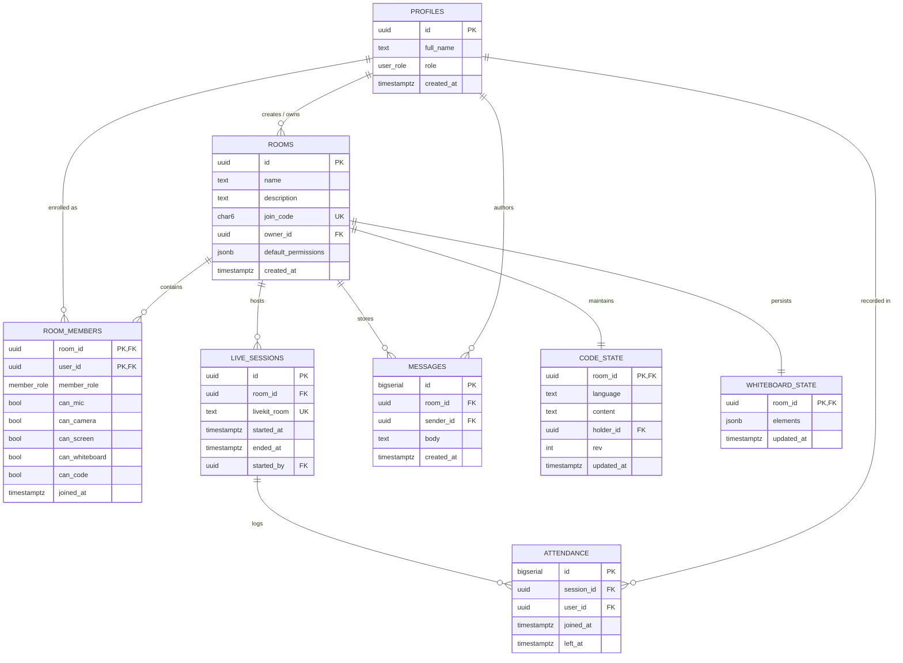

# LinkUp — Comprehensive Project Documentation & Technical Overview

> **A Unified Real-Time Collaborative Classroom Workspace with Granular, Server-Enforced Host Permissions**

---

## Table of Contents
1. [Executive Summary & Project Idea](#1-executive-summary--project-idea)
2. [Problem Statement & Core Value Proposition](#2-problem-statement--core-value-proposition)
3. [System Architecture & How LinkUp Works](#3-system-architecture--how-linkup-works)
4. [Technology Stack, APIs & Third-Party Services](#4-technology-stack-apis--third-party-services)
   - [Why Each Technology Was Chosen & Its Importance](#why-each-technology-was-chosen--its-importance)
   - [Reference Table: Libraries, APIs, and Official Sources](#reference-table-libraries-apis-and-official-sources)
5. [In-Depth Feature Breakdown](#5-in-depth-feature-breakdown)
   - [5.1 Authentication & Profile Management](#51-authentication--profile-management)
   - [5.2 Room Management & Join System](#52-room-management--join-system)
   - [5.3 Host-Controlled Permission Engine (Core Differentiator)](#53-host-controlled-permission-engine-core-differentiator)
   - [5.4 Live Audio, Video & Screen Sharing](#54-live-audio-video--screen-sharing)
   - [5.5 Collaborative Code Editor & Sandbox Execution](#55-collaborative-code-editor--sandbox-execution)
   - [5.6 Interactive Shared Whiteboard](#56-interactive-shared-whiteboard)
   - [5.7 Real-Time Classroom Chat](#57-real-time-classroom-chat)
   - [5.8 Automated Attendance Tracking & Analytics](#58-automated-attendance-tracking--analytics)
   - [5.9 Hand Raising & Interactive Feedback](#59-hand-raising--interactive-feedback)
6. [Data Model & Database Design](#6-data-model--database-design)
7. [Security & Enforcement Architecture](#7-security--enforcement-architecture)
8. [Future Scope & Roadmap](#8-future-scope--roadmap)
9. [Conclusion & Project Impact](#9-conclusion--project-impact)

---

## 1. Executive Summary & Project Idea

**LinkUp** is an all-in-one virtual classroom and collaborative engineering workspace designed specifically for educational institutions, coding bootcamps, and technical mentors. 

In conventional online education setups, instructors and students must juggle four to six disparate applications simultaneously:
- **Video conferencing** via Zoom / Google Meet / Microsoft Teams
- **Text discussions** via WhatsApp / Slack / Discord
- **Code authoring & execution** via Replit / OnlineGDB / GitHub Codespaces
- **Whiteboarding & diagramming** via Miro / Excalidraw / Google Jamboard
- **Course administration & attendance** via Google Classroom / spreadsheets

Each of these independent tools operates in its own silo with separate permissions, disconnected authentication, and zero coordination. Teachers lack a centralized control panel to govern what individual students can do during an active lecture, leading to classroom disruptions, distracted students, and fragmented learning workflows.

**The LinkUp Solution:**
LinkUp unifies live video/audio, screen sharing, persistent chat, a shared whiteboard, and a multi-language executable code editor under **one unified workspace** governed by a **single teacher-controlled permission panel**.

```
Teacher clicks "Allow Code" for Priya:
   ├── 1. Express backend verifies host authorization (<5 ms)
   ├── 2. PostgreSQL updates member record
   ├── 3. Socket.IO broadcasts `perm:changed` to the classroom (<50 ms)
   ├── 4. Priya's Monaco editor unlocks into interactive edit mode (<500 ms)
   ├── 5. All other students remain locked in read-only view
   └── 6. Server enforces that code updates are strictly accepted from the pen holder only
```

---

## 2. Problem Statement & Core Value Proposition

### 2.1 The Problem
1. **Context Switching Cognitive Load**: Switching between browser tabs for video calls, online compilers, whiteboards, and chat creates constant distraction and kills student engagement.
2. **Lack of Centralized Classroom Control**: Generic meeting tools (Meet/Teams) only offer blunt binary controls (mute all or kick out). They provide no way to say: *"Priya can code on the editor, Rahul can draw on the whiteboard, while the rest of the class can watch and listen."*
3. **Collaboration Chaos**: Without synchronized state and role governance, multiple students typing simultaneously in a code editor or drawing over a canvas results in vandalism and chaos.
4. **Attendance Inaccuracy**: Manual roll-calls waste 10–15 minutes of lecture time, and naive meeting logs fail to track network drops, reconnection events, or true engagement duration.

### 2.2 Core Value Proposition
- **Single Pane of Glass**: Everything required for a technical class exists within one cohesive URL.
- **Granular 5-Way Permission Model**: Real-time permission controls for `canMic`, `canCamera`, `canScreen`, `canWhiteboard`, and `canCode`.
- **True Multi-Layer Enforcement**: Permissions are not just cosmetic UI buttons; they are enforced at the network protocol layer (LiveKit SFU track gates), WebSocket handler layer, and REST API middleware layer.
- **Built-in Sandboxed Execution**: Execute Python, JavaScript, C++, and Java safely without installing local runtimes.
- **Automated, Tamper-Proof Attendance**: Session-based join/leave logging with built-in reconnect grace periods and one-click CSV export.

---

## 3. System Architecture & How LinkUp Works

LinkUp is built using a modern, scalable full-stack client-server architecture with specialized real-time media and execution engines.

```mermaid
flowchart TD
    subgraph Clients["Frontend Clients (React 18 + Vite SPA)"]
        Teacher["Teacher / Host Browser"]
        Student["Student / Participant Browser"]
    end

    subgraph ExternalAuth["Identity & Auth"]
        SupaAuth["Supabase Auth (JWT & Session Management)"]
    end

    subgraph AppServer["LinkUp Application Server (Node.js + Express + TypeScript)"]
        REST["Express REST API (/api/*)"]
        SIO["Socket.IO Gateway (State & Realtime Events)"]
        PermEngine["Permission & Authorization Engine"]
        AttService["Attendance & Session Lifecycle Manager"]
    end

    subgraph DataLayer["Persistence Layer"]
        SupaDB[("Supabase PostgreSQL Database")]
    end

    subgraph MediaInfra["WebRTC SFU Media Infrastructure"]
        LiveKitCloud["LiveKit Cloud SFU (Audio, Video, Screen Share)"]
    end

    subgraph ExecutionSandbox["Isolated Code Execution"]
        PistonEngine["Piston Code Execution Sandbox (Docker Container)"]
    end

    %% Auth Flows
    Teacher & Student -->|1. Sign in / Obtain JWT| SupaAuth
    Teacher & Student -->|2. REST API Requests (Bearer JWT)| REST
    Teacher & Student <-->|3. WebSockets (Bidirectional State Sync)| SIO
    Teacher & Student <-->|4. WebRTC Media Streams (Encrypted Tracks)| LiveKitCloud

    %% Server Internal Routing
    REST --> PermEngine
    SIO --> PermEngine
    REST --> AttService
    SIO --> AttService

    %% Backend to Storage & Services
    AppServer -->|Service-Role Key (Bypasses RLS)| SupaDB
    AppServer -->|Mint Access Tokens & Revoke Tracks dynamically| LiveKitCloud
    AppServer -->|POST /api/v2/execute (Sandboxed code run)| PistonEngine
```

### High-Level Architecture Flow
1. **Authentication Flow**: Users register and log in via Supabase Auth. Upon successful login, the browser receives an access JWT. The backend Express server validates this JWT for every incoming REST request and Socket.IO connection.
2. **Room & Session Model**:
   - A **Room** is a persistent classroom (e.g., *"Computer Science 101"*). Chat history, whiteboard diagrams, code files, and student permission profiles persist across sessions.
   - A **Session** represents a single live lecture within a room. Starting a session spins up a LiveKit room and initiates attendance logging. Ending a session closes all attendance records and deletes the LiveKit room.
3. **Data Communication Layers**:
   - **REST API**: Handles CRUD operations (room creation, joining via 6-character code, profile updates, manual member removals, and token minting).
   - **Socket.IO**: Handles real-time messaging, cursor presence, whiteboard drawing delta broadcasts, code editor sync, hand-raising events, and instantaneous permission updates.
   - **LiveKit Cloud**: Handles heavy audio, video, and screen-sharing media tracks over WebSockets and WebRTC via a high-performance Selective Forwarding Unit (SFU).
   - **Piston Sandbox**: Executes user-submitted code in an isolated, secure Docker container and returns formatted execution output.

---

## 4. Technology Stack, APIs & Third-Party Services

### Why Each Technology Was Chosen & Its Importance

#### 1. Supabase (Auth & PostgreSQL Database)
- **Website**: [https://supabase.com](https://supabase.com)
- **What it is**: An open-source Firebase alternative built on enterprise-grade PostgreSQL.
- **Why we used it**:
  - Provides a pre-built, secure authentication system supporting email/password, session refreshing, and JWT token issuance out of the box.
  - Robust relational PostgreSQL engine with native support for `UUID`, `JSONB`, relational foreign keys, cascade deletes, and timestamp tracking.
- **Importance in LinkUp**:
  - Eliminates the need to build and maintain vulnerable custom password hashing, token rotation, and auth infrastructure.
  - Allows LinkUp to implement a strict security model: Row Level Security (RLS) is enabled on all tables with zero public access policies. The client browser never interacts with the database directly; only the trusted Express server interacts with PostgreSQL via the privileged `SUPABASE_SERVICE_ROLE_KEY`.

#### 2. LiveKit Cloud (WebRTC SFU Infrastructure)
- **Website**: [https://livekit.io](https://livekit.io)
- **What it is**: Modern, open-source WebRTC infrastructure and cloud SFU (Selective Forwarding Unit).
- **Why we used it**:
  - Traditional mesh WebRTC (peer-to-peer) collapses when more than 4 or 5 users join a call because every participant must upload their video stream to every other participant ($O(N^2)$ bandwidth complexity).
  - LiveKit uses an SFU where each participant uploads their stream once to the server, and the server selectively distributes it to viewers ($O(N)$ bandwidth complexity).
  - Offers enterprise-grade TURN/STUN servers that bypass restrictive college firewalls and symmetric NATs.
  - Provides official React hooks (`@livekit/components-react`) and server SDKs (`livekit-server-sdk`).
- **Importance in LinkUp**:
  - LiveKit allows **server-side track manipulation**. When a teacher turns off a student's camera or microphone, the Express backend calls LiveKit's `updateParticipant` API to remove publish grants. The SFU instantly cuts the incoming audio/video stream at the media server level, ensuring the student cannot transmit media even if they manipulate their client browser code.

#### 3. Excalidraw (`@excalidraw/excalidraw`)
- **Website**: [https://excalidraw.com](https://excalidraw.com) | [GitHub Repository](https://github.com/excalidraw/excalidraw)
- **What it is**: A collaborative virtual whiteboard library with an intuitive hand-drawn aesthetic.
- **Why we used it**:
  - **Permissive Open-Source Licensing (MIT)**: Other popular options like `tldraw` enforce restrictive commercial licensing keys in production (stopping canvas rendering after 5 seconds without a key or forcing non-commercial watermarks). Excalidraw is completely open-source without arbitrary runtime restrictions.
  - Features built-in shapes, arrows, freehand pens, highlighters, text tools, zooming, panning, and color palettes.
  - Native `viewModeEnabled` prop allowing clean transition between interactive drawing and read-only viewing.
- **Importance in LinkUp**:
  - Powers LinkUp's interactive whiteboard tab. Uses an element-level version reconciliation algorithm (`version`, `versionNonce`) over Socket.IO to broadcast strokes in real-time while persisting full canvas snapshots to PostgreSQL.

#### 4. Monaco Editor (`@monaco-editor/react`)
- **Website**: [https://microsoft.github.io/monaco-editor](https://microsoft.github.io/monaco-editor) | [GitHub Repository](https://github.com/suren-atoyan/monaco-react)
- **What it is**: The core code editor component that powers Visual Studio Code.
- **Why we used it**:
  - Industry gold standard for code editing in the browser.
  - Out-of-the-box syntax highlighting, auto-indentation, line numbers, bracket matching, code folding, and auto-completion for Python, JavaScript, C++, Java, and hundreds of other languages.
  - Smooth integration with custom VS Code themes (such as VS Dark).
- **Importance in LinkUp**:
  - Provides a professional coding environment for students and teachers. Supports programmatic `readOnly` switching, line markers, and debounced delta synchronization across connected classroom peers.

#### 5. Piston (Sandboxed Code Execution Engine)
- **Website**: [https://github.com/engineer-man/piston](https://github.com/engineer-man/piston)
- **What it is**: A high-performance, secure code execution engine designed to compile and run arbitrary untrusted code inside isolated Docker environments.
- **Why we used it**:
  - Running student code directly on an application server is an extreme security hazard (risk of fork bombs, infinite loops, memory leaks, and filesystem tampering).
  - Public execution APIs (like standard online compilers) are either heavily rate-limited, charge expensive subscription tiers, or have disabled free public keys (e.g. emkc.org deprecated unauthenticated access).
  - Piston can be easily self-hosted via Docker containerization with `--privileged` isolation, supporting over 30 runtimes.
- **Importance in LinkUp**:
  - Powers LinkUp's "Run Code" feature. The Express server validates input size ($\le 64\text{ KB}$), enforces rate limits (max 10 runs per minute per user), sets strict CPU timeouts (3000 ms) and memory limits (256 MB), sends the code to Piston, and returns standard output (`stdout`), standard error (`stderr`), and execution times back to the classroom.

#### 6. Socket.IO (`socket.io` & `socket.io-client`)
- **Website**: [https://socket.io](https://socket.io)
- **What it is**: An event-driven library for real-time, bi-directional communication between web clients and Node.js servers.
- **Why we used it**:
  - Automatically manages WebSocket connections with graceful HTTP long-polling fallback.
  - Built-in room abstractions (`socket.join('room:123')`) allowing messages to be broadcast to specific classrooms without bleeding into others.
  - Supports client-side acknowledgment callbacks (`ack`) for reliable delivery and error propagation.
- **Importance in LinkUp**:
  - Acts as the central nervous system of LinkUp for presence indicators, live chat, whiteboard element streaming, code updates, pen-holder assignments, and permission change notifications.

#### 7. Express.js, TypeScript & Zod
- **Websites**: [Express.js](https://expressjs.com) | [TypeScript](https://www.typescriptlang.org) | [Zod](https://zod.dev)
- **Why we used them**:
  - Express provides a minimal, battle-tested HTTP server structure with middleware pipelines.
  - TypeScript ensures end-to-end type safety between the frontend (`client/`), backend (`server/`), and shared contracts (`shared/`).
  - Zod enforces strict runtime schema validation on every single incoming REST request payload and Socket.IO message before execution.
- **Importance in LinkUp**:
  - Prevents invalid data, unexpected crashes, and code injection vulnerabilities.

---

### Reference Table: Libraries, APIs, and Official Sources

| Component / Feature | Technology / API | Source / Official Website | Primary Purpose in LinkUp |
| :--- | :--- | :--- | :--- |
| **Authentication** | Supabase Auth | [supabase.com/docs/guides/auth](https://supabase.com/docs/guides/auth) | Email/password sign-up, login, and JWT access tokens |
| **Database** | PostgreSQL on Supabase | [supabase.com/docs/guides/database](https://supabase.com/docs/guides/database) | Relational database with strict RLS and foreign key integrity |
| **Audio / Video / Screen** | LiveKit Cloud WebRTC SFU | [livekit.io](https://livekit.io) | Multi-party audio/video conferencing and screen share |
| **Media React Hooks** | `@livekit/components-react` | [docs.livekit.io/frontends/react](https://docs.livekit.io/frontends/react/) | Video tiles, audio renderers, and device selector integration |
| **Realtime Messaging** | Socket.IO (v4) | [socket.io](https://socket.io) | Low-latency state sync, chat, presence, and permission broadcasts |
| **Collaborative Canvas** | Excalidraw | [excalidraw.com](https://excalidraw.com) | Interactive drawing board with SVG export and version tracking |
| **Shared Code Editor** | Monaco Editor | [microsoft.github.io/monaco-editor](https://microsoft.github.io/monaco-editor) | VS Code-style editor with syntax highlighting for multiple languages |
| **Code Execution Engine** | Piston (Docker) | [github.com/engineer-man/piston](https://github.com/engineer-man/piston) | Sandboxed, resource-limited compilation and execution engine |
| **Backend Framework** | Node.js + Express | [expressjs.com](https://expressjs.com) | REST API endpoints, middleware guards, and Socket.IO server |
| **Schema Validation** | Zod | [zod.dev](https://zod.dev) | Type-safe runtime input validation on REST bodies and socket events |
| **Frontend Framework** | React 18 + Vite | [vitejs.dev](https://vitejs.dev) | Client single-page application (SPA) with fast hot reloading |
| **CSS & Design System** | Tailwind CSS | [tailwindcss.com](https://tailwindcss.com) | Responsive utility styling, dark mode, and sleek dashboard UI |
| **Icons & Visuals** | Lucide React | [lucide.dev](https://lucide.dev) | Crisp, modern iconography across all controls and dialogs |

---

## 5. In-Depth Feature Breakdown

### 5.1 Authentication & Profile Management
- **Self-Service Role Selection**: Users sign up with their email, password, full name, and designated role (`teacher` or `student`).
- **Database Trigger Automation**: When a new user registers via Supabase Auth, a PostgreSQL trigger automatically initializes a matching record in the `public.profiles` table.
- **Secure Token Flow**: All API requests carry an `Authorization: Bearer <JWT>` header. The backend validates the signature, extracts user claims, and decorates incoming requests with `req.user`.
- **Profile Updates**: Users can update their display name at any time, which propagates in real-time to active classrooms.

### 5.2 Room Management & Join System
- **Teacher Room Creation**: Only users with the `teacher` role can create new classrooms. Teachers define room names, optional descriptions, and customizable default permissions for incoming students.
- **6-Character Alphanumeric Join Codes**: Rooms are assigned a unique, human-friendly 6-character code (e.g., `A9X2K4`). Students join instantaneously by entering this code on their dashboard.
- **Join Code Regeneration**: If an unauthorized user gains access to a room code, the host can regenerate the code with a single click, instantly invalidating the old one.
- **Member Management**: Hosts can view the full roster of enrolled students and permanently remove disruptive participants. Removing a member instantly revokes their session tokens, disconnects their WebRTC tracks, and expels them from the room.

### 5.3 Host-Controlled Permission Engine (Core Differentiator)
The central breakthrough of LinkUp is its **granular, 5-pillar permission engine**:

```
                       ┌───────────────────────────────────────┐
                       │   Teacher Permission Control Panel   │
                       └──────────────────┬────────────────────┘
                                          │
       ┌───────────────┬──────────────────┼──────────────────┬───────────────┐
       ▼               ▼                  ▼                  ▼               ▼
   [ canMic ]    [ canCamera ]      [ canScreen ]     [ canWhiteboard ]  [ canCode ]
       │               │                  │                  │               │
       ├───────────────┴──────────────────┤                  │               │
       ▼                                  ▼                  ▼               ▼
 LiveKit Cloud SFU Grants         LiveKit Screen SFU   Excalidraw Mode  Monaco Editor
 (Server-side track unpublish)   (Server-side track)   (viewModeEnabled) (readOnly flag)
```

1. **Microphone (`canMic`)**: Enables or disables student audio publishing. If revoked while speaking, the server mutes the track immediately.
2. **Camera (`canCamera`)**: Enables or disables student webcam video feeds.
3. **Screen Share (`canScreen`)**: Grants or revokes permission to share desktop screens or application windows.
4. **Whiteboard (`canWhiteboard`)**: Toggles the student between interactive drawing and read-only view.
5. **Code Editor (`canCode`)**: Determines whether a student is eligible to hold the "coding pen" and execute programs.

**Bulk Permission & "Mute All"**:
With one click on the "Mute All" button, the teacher can simultaneously revoke microphone permissions for all non-host participants, restoring order during noisy discussions.

**Interactive Toast Notifications**:
Whenever a permission is updated, the affected student receives a clear, non-intrusive toast alert (e.g., *"Teacher has enabled your microphone"* or *"Your code editing permission was revoked"*).

### 5.4 Live Audio, Video & Screen Sharing
- **Responsive Video Grid**: Automatically arranges participant video tiles dynamically based on the number of active feeds.
- **Active Speaker & Mute Indicators**: Clearly marks participants who are actively speaking or muted.
- **Screen Sharing**: High-resolution screen capture with support for window, tab, or full-screen sharing with system audio.
- **Media Device Selection**: Users can switch webcams, microphones, and audio output speakers on the fly using a dedicated device picker modal.
- **Graceful Host Leaves**: If a teacher accidentally closes their tab without ending the session, students remain in the meeting room while a grace timer awaits host reconnection.

### 5.5 Collaborative Code Editor & Sandbox Execution
- **The "Pass-the-Pen" Model**:
  - Rather than messy multi-cursor conflicts where multiple students type over each other, LinkUp implements an orderly **Editor-Holder** paradigm.
  - Exactly one participant holds the editing pen at any given time.
  - The teacher can take the pen back at any moment or pass it to any student who has the `canCode` permission.
  - Students can click **"Request Pen"** to notify the teacher that they wish to write or debug code.
- **Multi-Language Support**:
  - Native syntax highlighting and execution for **Python 3**, **JavaScript (Node.js)**, **C++ (GCC)**, and **Java (OpenJDK)**.
- **Sandboxed Execution via Piston**:
  - Code runs with strict execution timeouts (3 seconds) and memory limits (256 MB).
  - Handles interactive standard input (`stdin`).
  - Terminal output displays formatted `stdout`, highlighted runtime errors (`stderr`), exit codes, and execution duration in milliseconds.
  - Results are broadcast synchronously to all students in the room so the entire class sees the output together.

### 5.6 Interactive Shared Whiteboard
- **Seamless Excalidraw Integration**: Provides a full suite of diagramming tools: rectangles, diamonds, circles, arrows, lines, freehand drawing, text, highlighters, and eraser.
- **Versioned Delta Synchronization**:
  - Changes are tracked by element IDs and versions.
  - Only modified elements are broadcast over Socket.IO (throttled to 100 ms intervals), minimizing bandwidth consumption.
  - Conflicting edits are resolved automatically by element timestamp and version nonces.
- **Strict Read-Only Enforcement**:
  - Students without `canWhiteboard` permission have their Excalidraw instance locked in `viewModeEnabled`, preventing toolbar interaction.
  - The server drops unauthorized whiteboard socket packets even if a malicious user bypasses frontend UI locks.
- **Automatic State Persistence**:
  - Whiteboard state is debounced and saved to PostgreSQL, ensuring drawings remain intact when users refresh or return to the room tomorrow.

### 5.7 Real-Time Classroom Chat
- **Integrated Room Chat**: Persistent messaging sidebar accessible across all tabs.
- **Message History**: When a user joins or navigates into a room, historical messages are fetched via a paginated REST endpoint.
- **Rich Formatting & Auto-Link Detection**: URLs sent in chat are automatically formatted into secure, clickable hyperlinks (`target="_blank" rel="noopener noreferrer"`).
- **Sender Metadata**: Each message displays sender name, timestamp, and a distinguished badge indicating whether the sender is a `Teacher` or `Student`.
- **Optimistic UI Updates**: Messages appear in the sender's chat log immediately with an acknowledgment status, preventing perceived UI lag.

### 5.8 Automated Attendance Tracking & Analytics
- **Zero-Effort Automated Logging**: Attendance is captured silently in the background whenever a live session is active.
- **15-Second Reconnect Grace Window**:
  - If a student experiences a temporary Wi-Fi dropout or reloads their browser, LinkUp does not create a false "left and rejoined" record.
  - An in-memory grace timer holds the record open for 15 seconds. If the user reconnects within this window, the existing session log continues seamlessly.
- **Comprehensive Session Analytics**:
  - Hosts have access to an Attendance tab displaying:
    - Student Full Name & Email
    - Initial Join Time (formatted in local timezone)
    - Final Leave Time
    - Total Active Duration in Minutes
    - Total Join/Disconnect Count
- **One-Click CSV Export**:
  - Hosts can download a clean `.csv` attendance report ready for import into institutional gradebooks and ERP systems.

### 5.9 Hand Raising & Interactive Feedback
- **Non-Verbal Communication**: Students can raise or lower their virtual hand.
- **Visual Notification for Host**: An indicator appears next to the student's name in the Participants panel and on their video tile, signaling to the teacher that they have a question or wish to speak.

---

## 6. Data Model & Database Design

LinkUp's database is modeled around strict relational integrity in PostgreSQL:



### Table Schema Summary

1. **`profiles`**: Stores user identity, display name, and system role (`teacher` or `student`). References `auth.users(id)` via cascade deletion.
2. **`rooms`**: Represents the persistent classroom, storing name, description, owner ID, unique 6-character `join_code`, and baseline default permissions.
3. **`room_members`**: Join table storing user membership, role in that specific room (`host` vs `participant`), and the five permission booleans (`can_mic`, `can_camera`, `can_screen`, `can_whiteboard`, `can_code`).
4. **`live_sessions`**: Tracks live calls within a room, including the unique LiveKit room name, start time, end time, and host ID.
5. **`attendance`**: Records every participant's join time and leave time per session. A partial unique index `(session_id, user_id) WHERE left_at IS NULL` guarantees at most one open record per user.
6. **`messages`**: Contains persistent chat messages linked to room ID and sender ID.
7. **`code_state`**: Stores the latest code buffer, selected programming language, active pen holder ID, and monotonic revision number for each room.
8. **`whiteboard_state`**: Stores the serialized JSON array of Excalidraw elements for each room.

---

## 7. Security & Enforcement Architecture

LinkUp adopts a **Defense-in-Depth** security philosophy across three distinct layers:

```
┌─────────────────────────────────────────────────────────────┐
│                 Layer 1: User Interface (UI)                │
│  - Buttons disabled & tooltips display reason               │
│  - Monaco editor sets readOnly: true                        │
│  - Excalidraw sets viewModeEnabled: true                    │
└──────────────────────────────┬──────────────────────────────┘
                               │
┌──────────────────────────────▼──────────────────────────────┐
│              Layer 2: Application Server Middleware          │
│  - requireAuth checks Supabase JWT validity                  │
│  - requireMember verifies student belongs to the room        │
│  - requireHost verifies request is from room owner           │
│  - Socket handlers verify permissions on EVERY event         │
└──────────────────────────────┬──────────────────────────────┘
                               │
┌──────────────────────────────▼──────────────────────────────┐
│           Layer 3: Infrastructure & Sandbox Gates            │
│  - LiveKit SFU denies publishing unauthorized tracks         │
│  - LiveKit updateParticipant server API revokes live feeds   │
│  - Piston limits container CPU (3s) and RAM (256MB)          │
│  - PostgreSQL RLS enabled with zero public policies          │
└─────────────────────────────────────────────────────────────┘
```

1. **Row-Level Security (RLS) Isolation**:
   - Every table in PostgreSQL has RLS enabled with **zero client policies**.
   - The browser client is never issued credentials capable of reading or writing the database. Even if the Supabase anonymous key is exposed in the frontend bundle, an attacker cannot query any table.
   - All database access occurs exclusively through the backend Express server using the secure `SUPABASE_SERVICE_ROLE_KEY`.

2. **Network Protocol Level Revocation**:
   - Many WebRTC apps only disable the microphone in the client UI. A tech-savvy student can open DevTools and call `stream.getAudioTracks()[0].enabled = true` to unmute themselves.
   - In LinkUp, revoking a permission triggers a server-to-server call to LiveKit Cloud via `RoomServiceClient.updateParticipant()`. LiveKit's SFU severs the WebRTC ingest pipeline on the media server itself.

3. **Execution Sandbox Hardening**:
   - Piston executes code under unprivileged user namespaces within Docker containers.
   - Outbound network requests inside the execution container can be restricted to prevent SSRF attacks.
   - Input payloads are limited to 64 KB, and execution output is truncated to prevent terminal flooding and memory exhaustion.

---

## 8. Future Scope & Roadmap

While LinkUp provides a complete, production-ready MVP for technical classrooms, several high-value capabilities can expand its scope:

### 1. Cloud Session Recording & Transcription (LiveKit Egress)
- **Concept**: Integrate LiveKit Egress services to record composite video, screen share, and audio directly to S3-compatible cloud storage (such as AWS S3 or Cloudflare R2).
- **AI Transcription**: Pipe recorded audio through OpenAI Whisper to generate automated, timestamped lecture transcripts and searchable notes for students.

### 2. Concurrent Multi-Cursor Collaborative Code Editing (CRDT / Yjs)
- **Concept**: Upgrade from the current "single pen-holder" model to real-time multi-cursor co-editing (similar to Google Docs or VS Code Live Share).
- **Implementation**: Utilize **Yjs** paired with `y-monaco` and a WebSocket provider (`y-websocket` or Hocuspocus). This will allow small student study groups to edit multiple functions in the same file simultaneously without conflicts.

### 3. Breakout Rooms
- **Concept**: Allow teachers to split a large lecture of 40 students into smaller breakout rooms of 4–5 students for group exercises, pair programming, and lab assignments.
- **Control**: Teachers can broadcast announcements to all breakout rooms simultaneously or hop between rooms to mentor individual groups.

### 4. In-Workspace Assignments, Quizzes & Automated Grading
- **Concept**: Allow instructors to post coding problems with hidden unit test cases directly into the room.
- **Workflow**: Students solve the problem in their personal editor tab, submit code against test suites, and receive instant automated grading through Piston.

### 5. AI Teaching Assistant
- **Concept**: An integrated AI copilot trained to assist students when they get stuck on compiler errors without giving away direct assignment solutions.
- **Features**: Explains cryptic compiler warnings, suggests debugging strategies, and summarizes whiteboard sketches into conceptual study guides.

### 6. Institutional LMS & Single Sign-On (SSO) Integration
- **Concept**: Connect LinkUp with university authentication systems (SAML 2.0, Google Workspace for Education, Microsoft Entra ID).
- **LTI Compliance**: Implement Learning Tools Interoperability (LTI 1.3) standards to integrate seamlessly inside Canvas, Blackboard, and Moodle course pages.

### 7. Native Mobile & Tablet Applications
- **Concept**: Develop native iOS, iPadOS, and Android apps utilizing React Native and LiveKit Mobile SDKs, enabling students to participate in lectures, view whiteboards with stylus support (e.g. Apple Pencil), and chat on the go.

---

## 9. Conclusion & Project Impact

**LinkUp** solves one of the most persistent bottlenecks in modern technical education: the friction and distraction caused by juggling disconnected software tools during live instruction.

By combining:
- High-quality WebRTC audio/video/screen sharing (LiveKit Cloud)
- Vector-grade collaborative diagramming (Excalidraw)
- Industry-standard code authoring (Monaco Editor)
- Safe, multi-language sandbox execution (Piston)
- Automated attendance tracking and real-time chat

...all under a **strict, teacher-governed permission model**, LinkUp transforms virtual classrooms into focused, interactive, and disruption-free collaborative learning environments. It demonstrates how modern web standards, server-enforced security, and thoughtful UX can elevate remote learning to parity with—and in many aspects beyond—traditional physical classrooms.
