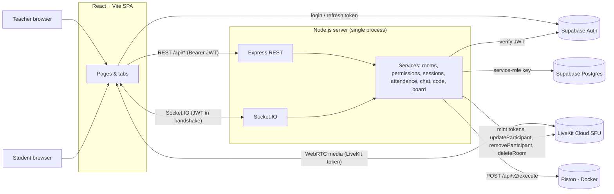
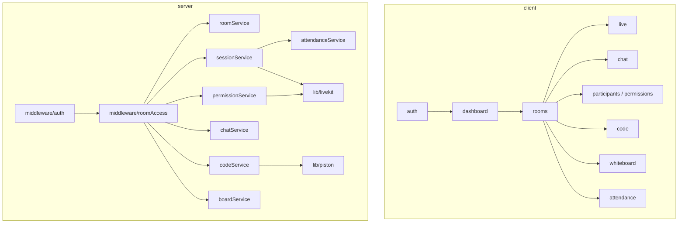
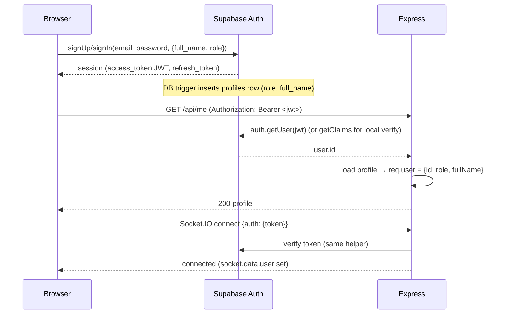
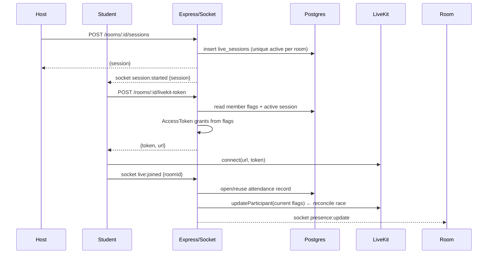
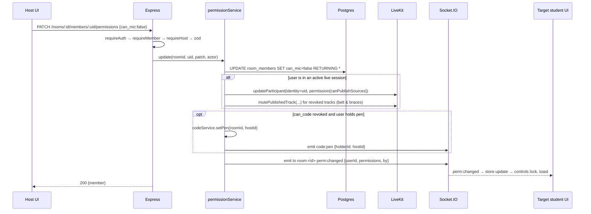

# Architecture — LinkUp MVP

Companion docs: [frd.md](./frd.md) (what) · [api-contract.md](./api-contract.md) (contracts) · [database.md](./database.md) (schema)

---

## 1. Architecture principles

1. **One gatekeeper.** Every read/write of app data goes through the Express backend. The browser uses Supabase **only for login**. RLS is on with no policies, so a leaked anon key can't read anything.
2. **Permissions are enforced where the action happens.** Media → LiveKit grants. REST → Express middleware. Real-time → Socket.IO handler guards. The UI only mirrors server state.
3. **One function changes permissions** — `permissionService.update()` writes the DB, updates LiveKit and broadcasts to the room. No other path is allowed to change permissions.
4. **Buy, don't build, the hard real-time parts.** LiveKit (SFU, TURN, reconnection), Excalidraw (canvas), Monaco (editor), Piston (sandbox).
5. **Single backend instance for the MVP.** Ephemeral real-time state (presence, pen holder, board cache) lives in memory and is persisted to Postgres on a debounce. The scale-out path is documented in §11, not built.

## 2. System context



| Component | Tech | Responsibility |
|-----------|------|----------------|
| SPA | React 18, Vite, TS, Tailwind, React Router, TanStack Query, Zustand | UI, local room state, media rendering |
| Auth | Supabase Auth (email/password) | Sign-up, login, JWT issuance & refresh |
| REST API | Express 4/5 + TS, zod validation | CRUD, permission changes, tokens, code execution proxy |
| Realtime | Socket.IO 4 | Presence, chat, permission events, code & whiteboard sync, attendance hooks |
| Media | LiveKit Cloud + `@livekit/components-react` | Audio, video, screen share; server-enforced publish rights |
| DB | Supabase Postgres | Users, rooms, members/permissions, sessions, attendance, messages, code & board state |
| Whiteboard | `@excalidraw/excalidraw` | Canvas; sync via Socket.IO |
| Editor | `@monaco-editor/react` | Code editing; sync via Socket.IO |
| Execution | Piston (self-hosted Docker) | Sandboxed run of Python/JS/C++/Java |

## 3. Logical modules



## 4. Room workspace model

```
Room (persistent class: "DSA Batch A")
 ├── members[] ............ role + 5 permission flags (persist across sessions)
 ├── messages[] ........... chat history
 ├── code_state ........... language, content, pen holder
 ├── whiteboard_state ..... Excalidraw elements JSON
 └── sessions[] ........... live meetings
       └── attendance[] ... join/leave records per user
```

- A **room** exists independently of any meeting. Chat, code and whiteboard work even when no session is live.
- A **session** is created by "Start session" and maps 1:1 to a LiveKit room named `linkup-<session_id>`. Ending the session deletes the LiveKit room, which disconnects everyone from media.
- The Socket.IO room `room:<room_id>` carries every real-time event for that room.

## 5. Key flows

### 5.1 Authentication



- Client: `supabase.auth.onAuthStateChange` keeps the token fresh. The API wrapper reads `session.access_token` on every call. On socket reconnect, the `auth` callback re-reads the latest token.
- Server: a 60 s in-memory cache of `token → user` avoids calling Supabase on every request.

**Express auth middleware (sketch)**

```ts
// server/src/middleware/auth.ts
export const requireAuth: RequestHandler = async (req, res, next) => {
  const token = req.headers.authorization?.replace(/^Bearer /, '');
  if (!token) return res.status(401).json({ error: { code: 'UNAUTHENTICATED' } });
  const user = await verifyToken(token);           // lib/supabase.ts, cached
  if (!user) return res.status(401).json({ error: { code: 'UNAUTHENTICATED' } });
  req.user = user;                                 // { id, role, fullName }
  next();
};

// server/src/middleware/roomAccess.ts
export const requireMember = asyncHandler(async (req, _res, next) => {
  const m = await roomService.getMember(req.params.roomId, req.user.id);
  if (!m) throw new HttpError(403, 'NOT_A_MEMBER');
  req.member = m;                                  // includes member_role + flags
  next();
});
export const requireHost = (req, _res, next) =>
  req.member.member_role === 'host' ? next() : next(new HttpError(403, 'HOST_ONLY'));
```

### 5.2 Start session and join live



**Token minting (sketch — verify against installed `livekit-server-sdk` version)**

```ts
// server/src/lib/livekit.ts
import { AccessToken, RoomServiceClient, TrackSource } from 'livekit-server-sdk';

export function sourcesFrom(m: MemberFlags) {
  const s: string[] = [];
  if (m.can_mic) s.push('microphone');
  if (m.can_camera) s.push('camera');
  if (m.can_screen) s.push('screen_share', 'screen_share_audio');
  return s;
}

export async function mintToken(user: User, member: Member, lkRoom: string) {
  const at = new AccessToken(env.LIVEKIT_API_KEY, env.LIVEKIT_API_SECRET, {
    identity: user.id, name: user.fullName, ttl: '2h',
    metadata: JSON.stringify({ role: member.member_role }),
  });
  const sources = member.member_role === 'host'
    ? ['microphone', 'camera', 'screen_share', 'screen_share_audio']
    : sourcesFrom(member);
  at.addGrant({
    room: lkRoom, roomJoin: true, canSubscribe: true,
    canPublish: sources.length > 0,
    canPublishSources: sources as any,
    canPublishData: false,           // chat goes over Socket.IO, not LiveKit data
    roomAdmin: member.member_role === 'host',
  });
  return at.toJwt();                 // async in SDK v2
}
```

### 5.3 Permission change (the core flow)



**Enforcement layers**

| Permission | Layer 1: UI | Layer 2: server | Layer 3: infra |
|------------|-------------|-----------------|----------------|
| `can_mic` / `can_camera` / `can_screen` | Buttons disabled + tooltip | Token grants derived from DB; `updateParticipant` on change | LiveKit SFU refuses to accept a publish for disallowed sources |
| `can_whiteboard` | Excalidraw `viewModeEnabled` | `wb:update` handler checks flag → drops + `error` | — |
| `can_code` | Monaco `readOnly`; pen buttons hidden | `code:update` accepted only from current pen holder; `setPen` requires target `can_code`; `/execute` with `roomId` requires holder or host | Piston sandbox limits |
| Host-only actions | Hidden for participants | `requireHost` middleware / socket handler check | — |

> **Day-1 spike to verify:** after `updateParticipant` removes a source from `canPublishSources`, confirm that LiveKit unpublishes an already-live track. If it doesn't in your SDK/server version, the `mutePublishedTrack` call plus the client-side `perm:changed` handler (which calls `localParticipant.setMicrophoneEnabled(false)`) cover it.

### 5.4 Chat

```
client  ──chat:send {roomId, body, clientId}──▶ server
server: member? → zod (1..2000 chars) → INSERT messages → emit chat:new to room:<id>
client: ack callback {ok, message} replaces the optimistic message (matched by clientId)
history: GET /rooms/:id/messages?before=<iso>&limit=50
```

### 5.5 Code workspace — pen-holder sync

```mermaid
sequenceDiagram
  participant P as Pen holder
  participant S as Server (codeService)
  participant V as Viewers
  P->>S: code:update {roomId, content, language}
  S->>S: socket.user == pen holder? else error FORBIDDEN
  S->>S: rev++ ; cache[roomId] = {content, language, rev}
  S-->>V: code:state {content, language, rev, holderId}
  S->>S: debounce 3s → UPSERT code_state
  Note over V: editor.setValue() keeping viewer's scroll position
```

- Holder emits on Monaco `onChange`, **debounced 150 ms**, sending the **full content** (≤ 64 KB — no diffing needed in the MVP).
- `code:pen` changes holder. The host can always take the pen. A participant can receive it only if `can_code = true`.
- Late joiners receive the current `code:state` in the `room:join` ack.

**Run**

```
Run click → POST /api/execute {roomId, language, code, stdin}
server: rate-limit (10/min/user) → size ≤ 64KB → if roomId: holder or host
      → emit code:run-started {by}
      → piston POST /api/v2/execute {language, version, files:[{content}], stdin,
                                      run_timeout: 3000, compile_timeout: 10000,
                                      run_memory_limit: 256MB}
      → normalize {stdout, stderr, exitCode, timeMs, timedOut}
      → emit code:run-result to room:<id>   (and return it in the HTTP response)
```

Language → version mapping lives in `server/src/lib/piston.ts`. It's loaded from `GET /api/v2/runtimes` at boot, so versions are never hard-coded wrong.

### 5.6 Whiteboard — Excalidraw element sync

```
editor onChange(elements)
  → changed = elements.filter(e => e.version > sentVersions[e.id])
  → throttle 100 ms → wb:update {roomId, elements: changed}
server: can_whiteboard or host? → merge into cache by id (keep higher version;
        tie → lower versionNonce wins) → broadcast wb:update to others
        → debounce 5 s → UPSERT whiteboard_state
viewer: reconcile same rule → excalidrawAPI.updateScene({ elements: merged })
        record versions as "seen" so the onChange it triggers is not re-broadcast
```

- Deletions sync naturally: Excalidraw marks `isDeleted: true` and bumps `version`.
- Read-only users: `<Excalidraw viewModeEnabled={!canEdit} />`.
- Late joiners get the full board in the `room:join` ack.
- Image elements are **not supported** in the MVP (they need file storage). Disable the image tool via `UIOptions`.

### 5.7 Attendance

```
socket live:joined {roomId}
  presence[roomId][userId].liveSockets.add(socket.id)
  if grace timer exists → clearTimeout (reconnect within 15 s: reuse open record)
  else if no open record for (session, user) → INSERT attendance(joined_at=now())

socket live:left | disconnect
  remove socket; if user has 0 live sockets left →
    start 15 s timer → UPDATE attendance SET left_at=now() WHERE open

session end → UPDATE attendance SET left_at = ended_at WHERE session_id=? AND left_at IS NULL
server boot → close any open records whose session is ended (crash recovery)
```

A partial unique index `(session_id, user_id) WHERE left_at IS NULL` guarantees at most one open record per user per session.

## 6. Server in-memory state (`realtime/state.ts`)

| Key | Shape | Persisted? |
|-----|-------|-----------|
| `presence` | `Map<roomId, Map<userId, {name, role, sockets:Set, liveSockets:Set, handRaised}>>` | No (derived) |
| `codeCache` | `Map<roomId, {content, language, rev, holderId}>` | Yes → `code_state` (debounced 3 s, plus on last member leave) |
| `boardCache` | `Map<roomId, Map<elementId, Element>>` | Yes → `whiteboard_state` (debounced 5 s, plus on last leave) |
| `graceTimers` | `Map<sessionId:userId, Timeout>` | No |
| `activeSession` | `Map<roomId, {sessionId, lkRoom}>` | Source of truth is DB; cache only |

On graceful shutdown (`SIGTERM`), flush the code and board caches before exit.

## 7. Repository structure

```
linkup/
├─ package.json                 # npm workspaces: client, server, shared
├─ shared/
│  └─ src/
│     ├─ events.ts              # ClientToServerEvents / ServerToClientEvents types
│     ├─ dto.ts                 # Room, Member, Message, Session, Attendance DTOs
│     └─ permissions.ts         # PERMISSION_KEYS, defaults, labels
├─ client/
│  └─ src/
│     ├─ App.tsx                # routes
│     ├─ lib/{supabase,api,socket}.ts
│     ├─ store/roomStore.ts     # zustand: members, perms, presence, pen, session
│     ├─ components/ui/         # Button, Modal, Toggle, Toast, Tabs, Avatar
│     └─ features/
│        ├─ auth/               # AuthProvider, ProtectedRoute, Login, Signup
│        ├─ dashboard/          # DashboardPage, RoomCard, CreateRoomModal, JoinByCode
│        ├─ rooms/              # RoomPage (layout), RoomHeader, useRoomSocket
│        ├─ live/               # LiveTab, ControlBar, useLiveSession, PermissionSync
│        ├─ chat/               # ChatPanel, MessageList, useChat
│        ├─ participants/       # ParticipantsPanel, PermissionToggles
│        ├─ code/               # CodeTab, useCodeSync, OutputPanel, LanguageSelect
│        ├─ whiteboard/         # WhiteboardTab, useBoardSync, reconcile.ts
│        ├─ attendance/         # AttendancePage
│        └─ playground/         # PlaygroundPage (P1)
├─ server/
│  └─ src/
│     ├─ index.ts               # http server + express + socket.io bootstrap
│     ├─ config/env.ts          # zod-validated env
│     ├─ lib/{supabase,livekit,piston}.ts
│     ├─ middleware/{auth,roomAccess,validate,rateLimit,error}.ts
│     ├─ routes/{me,rooms,members,sessions,livekit,messages,attendance,execute}.ts
│     ├─ services/{room,permission,session,attendance,chat,code,board}Service.ts
│     ├─ realtime/
│     │  ├─ io.ts               # socket auth middleware, connection wiring
│     │  ├─ state.ts
│     │  └─ handlers/{room,chat,code,board,hand}.ts
│     └─ utils/{joinCode,errors,asyncHandler}.ts
├─ supabase/migrations/0001_init.sql
├─ infra/
│  ├─ piston/docker-compose.yml + install-runtimes.sh
│  └─ deploy/{docker-compose.prod.yml, Caddyfile}
└─ docs/                        # these documents
```

## 8. Configuration

| Variable | Where | Example / note |
|----------|-------|----------------|
| `VITE_SUPABASE_URL` | client | `https://xyz.supabase.co` |
| `VITE_SUPABASE_ANON_KEY` | client | Publishable/anon key (safe in the browser because RLS has no policies) |
| `VITE_API_URL` | client | `http://localhost:4000` |
| `VITE_LIVEKIT_URL` | client | `wss://<project>.livekit.cloud` (the server also returns it with each token) |
| `PORT` | server | `4000` |
| `CLIENT_ORIGIN` | server | CORS + Socket.IO origin allow-list (comma-separated) |
| `SUPABASE_URL` | server | |
| `SUPABASE_SERVICE_ROLE_KEY` | server | **Secret.** Never commit it. |
| `LIVEKIT_URL` | server | `wss://…` |
| `LIVEKIT_API_KEY` / `LIVEKIT_API_SECRET` | server | **Secret** |
| `PISTON_URL` | server | `http://localhost:2000` or the VPS internal URL |
| `RUN_TIMEOUT_MS` / `RUN_RATE_PER_MIN` | server | `3000` / `10` |

Commit `.env.example` files only; real values go in a shared password manager.

## 9. Deployment (Day 9 — needed for a two-device demo)

Browsers allow camera, mic and screen capture only on `https://` or `localhost`.

```
                 ┌──────────────── Vercel / Netlify ────────────────┐
 browser ──https─▶  client (static build)                           │
                 └───────────────────────────────────────────────────┘
          ──wss/https─▶ ┌──────── Linux VPS (2 vCPU / 4 GB) ───────────┐
                        │ Caddy (auto TLS) → server:4000 (Express+IO)  │
                        │                    piston:2000 (internal)    │
                        └───────────────────────────────────────────────┘
          ──wss───────▶ LiveKit Cloud        Supabase (managed)
```

- `docker-compose.prod.yml` runs `server`, `piston` (`privileged: true`) and `caddy`. Piston is **not** exposed publicly.
- Alternative: the server on Render/Railway (both support WebSockets) and Piston alone on the VPS.
- Single instance only. Sticky sessions aren't needed because there's one process.

## 10. Security checklist

- [ ] Service-role key and LiveKit secret exist only in server env
- [ ] RLS enabled on all tables, no policies (backend-only access)
- [ ] `helmet`, CORS allow-list, `express.json({ limit: '100kb' })`
- [ ] zod validation on every REST body and socket payload
- [ ] Socket handlers re-check membership and permission on **every** event, not just at join
- [ ] Removing a member: delete row → `removeParticipant` in LiveKit → `socket.leave` + `room:kicked`
- [ ] Rate limits: `/execute` 10/min/user; chat 20 msgs/10 s/user (simple token bucket)
- [ ] Piston: run timeout 3 s, memory 256 MB, output truncated to 64 KB; not reachable from the internet
- [ ] No `dangerouslySetInnerHTML`; links rendered with `rel="noopener noreferrer"`

## 11. Scale-out path (post-MVP, not built)

| Need | Change |
|------|--------|
| More than 1 server instance | `@socket.io/redis-adapter`; move `presence`/`codeCache`/`boardCache` into Redis; sticky sessions at the LB |
| Concurrent code co-editing | Yjs + `y-monaco` + `y-websocket` (or Hocuspocus) |
| Recording | LiveKit Egress → S3-compatible bucket (Supabase Storage S3 or R2) + `recordings` table + retention cron |
| Attendance accuracy | LiveKit webhooks (`participant_joined/left`) as the source of truth |
| Heavy code-run load | Separate Piston pool behind a queue (BullMQ) |
| Multi-institution | `organizations` table and `org_id` on rooms; org admins |
