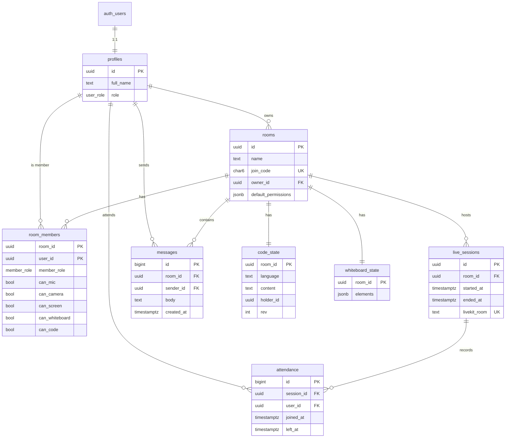

# Database — LinkUp MVP (Supabase Postgres)

## 1. Access model

- The **backend is the only DB client** and uses the service-role key via `supabase-js`. Aggregate queries use RPC functions (defined below).
- **RLS is enabled on every table with no policies.** The anon key in the browser therefore cannot read or write any app table. The browser uses Supabase only for Auth.
- All timestamps are `timestamptz` in UTC. Convert to IST in the UI.

## 2. ER diagram



## 3. Migration — `supabase/migrations/0001_init.sql`

```sql
-- ============ Types ============
create type public.user_role   as enum ('teacher', 'student');
create type public.member_role as enum ('host', 'participant');

-- ============ Profiles ============
create table public.profiles (
  id          uuid primary key references auth.users(id) on delete cascade,
  full_name   text not null check (char_length(full_name) between 1 and 100),
  role        public.user_role not null default 'student',
  created_at  timestamptz not null default now()
);

-- Auto-create a profile on signup from user metadata {full_name, role}
create or replace function public.handle_new_user()
returns trigger language plpgsql security definer set search_path = '' as $$
begin
  insert into public.profiles (id, full_name, role)
  values (
    new.id,
    coalesce(nullif(trim(new.raw_user_meta_data->>'full_name'), ''), split_part(new.email, '@', 1)),
    case when new.raw_user_meta_data->>'role' = 'teacher'
         then 'teacher'::public.user_role else 'student'::public.user_role end
  );
  return new;
end; $$;

create trigger on_auth_user_created
  after insert on auth.users
  for each row execute function public.handle_new_user();

-- ============ Rooms ============
create table public.rooms (
  id                   uuid primary key default gen_random_uuid(),
  name                 text not null check (char_length(name) between 1 and 80),
  description          text check (description is null or char_length(description) <= 500),
  join_code            char(6) not null unique,
  owner_id             uuid not null references public.profiles(id),
  default_permissions  jsonb not null default
    '{"can_mic":false,"can_camera":false,"can_screen":false,"can_whiteboard":false,"can_code":false}'::jsonb,
  archived_at          timestamptz,
  created_at           timestamptz not null default now()
);

-- ============ Members + permissions ============
create table public.room_members (
  room_id         uuid not null references public.rooms(id) on delete cascade,
  user_id         uuid not null references public.profiles(id) on delete cascade,
  member_role     public.member_role not null default 'participant',
  can_mic         boolean not null default false,
  can_camera      boolean not null default false,
  can_screen      boolean not null default false,
  can_whiteboard  boolean not null default false,
  can_code        boolean not null default false,
  joined_at       timestamptz not null default now(),
  updated_at      timestamptz not null default now(),
  primary key (room_id, user_id)
);
create index room_members_user_idx on public.room_members (user_id);

-- ============ Live sessions ============
create table public.live_sessions (
  id            uuid primary key default gen_random_uuid(),
  room_id       uuid not null references public.rooms(id) on delete cascade,
  started_by    uuid not null references public.profiles(id),
  started_at    timestamptz not null default now(),
  ended_at      timestamptz,
  livekit_room  text generated always as ('linkup-' || id::text) stored unique
);
-- at most one active session per room
create unique index live_sessions_one_active
  on public.live_sessions (room_id) where ended_at is null;

-- ============ Attendance ============
create table public.attendance (
  id          bigint generated always as identity primary key,
  session_id  uuid not null references public.live_sessions(id) on delete cascade,
  room_id     uuid not null references public.rooms(id) on delete cascade,
  user_id     uuid not null references public.profiles(id) on delete cascade,
  joined_at   timestamptz not null default now(),
  left_at     timestamptz,
  check (left_at is null or left_at >= joined_at)
);
-- at most one OPEN record per user per session (reconnect reuses it)
create unique index attendance_one_open
  on public.attendance (session_id, user_id) where left_at is null;
create index attendance_session_idx on public.attendance (session_id);

-- ============ Chat ============
create table public.messages (
  id          bigint generated always as identity primary key,
  room_id     uuid not null references public.rooms(id) on delete cascade,
  session_id  uuid references public.live_sessions(id) on delete set null,
  sender_id   uuid not null references public.profiles(id) on delete cascade,
  body        text not null check (char_length(body) between 1 and 2000),
  created_at  timestamptz not null default now()
);
create index messages_room_created_idx on public.messages (room_id, created_at desc);

-- ============ Code workspace ============
create table public.code_state (
  room_id     uuid primary key references public.rooms(id) on delete cascade,
  language    text not null default 'python'
              check (language in ('python','javascript','cpp','java')),
  content     text not null default '' check (octet_length(content) <= 65536),
  holder_id   uuid references public.profiles(id) on delete set null,
  rev         integer not null default 0,
  updated_at  timestamptz not null default now()
);

-- ============ Whiteboard ============
create table public.whiteboard_state (
  room_id     uuid primary key references public.rooms(id) on delete cascade,
  elements    jsonb not null default '[]'::jsonb,
  updated_at  timestamptz not null default now()
);

-- ============ RLS: on, no policies (backend-only access) ============
alter table public.profiles          enable row level security;
alter table public.rooms             enable row level security;
alter table public.room_members      enable row level security;
alter table public.live_sessions     enable row level security;
alter table public.attendance        enable row level security;
alter table public.messages          enable row level security;
alter table public.code_state        enable row level security;
alter table public.whiteboard_state  enable row level security;
```

## 4. RPC functions — `0002_rpc.sql`

```sql
-- Dashboard: rooms for a user with host name, member count, my role, active session
create or replace function public.my_rooms(p_user uuid)
returns table (
  id uuid, name text, description text, join_code char(6),
  host_name text, member_count bigint, my_role public.member_role,
  active_session_id uuid, created_at timestamptz
) language sql stable as $$
  select r.id, r.name, r.description,
         case when m.member_role = 'host' then r.join_code else null end,
         hp.full_name,
         (select count(*) from public.room_members x where x.room_id = r.id),
         m.member_role,
         (select s.id from public.live_sessions s where s.room_id = r.id and s.ended_at is null),
         r.created_at
  from public.room_members m
  join public.rooms r     on r.id = m.room_id and r.archived_at is null
  join public.profiles hp on hp.id = r.owner_id
  where m.user_id = p_user
  order by r.created_at desc;
$$;

-- Attendance summary for one session
create or replace function public.attendance_summary(p_session uuid)
returns table (user_id uuid, full_name text, first_join timestamptz,
               last_leave timestamptz, minutes int, joins bigint)
language sql stable as $$
  select a.user_id, p.full_name,
         min(a.joined_at),
         max(coalesce(a.left_at, now())),
         round(sum(extract(epoch from coalesce(a.left_at, now()) - a.joined_at)) / 60)::int,
         count(*)
  from public.attendance a
  join public.profiles p on p.id = a.user_id
  where a.session_id = p_session
  group by a.user_id, p.full_name
  order by p.full_name;
$$;

-- Atomic room creation: room + host member + empty code/board rows
create or replace function public.create_room(
  p_owner uuid, p_name text, p_description text, p_code char(6), p_defaults jsonb
) returns public.rooms language plpgsql as $$
declare r public.rooms;
begin
  insert into public.rooms (name, description, join_code, owner_id, default_permissions)
  values (p_name, p_description, p_code, p_owner, p_defaults) returning * into r;

  insert into public.room_members (room_id, user_id, member_role,
    can_mic, can_camera, can_screen, can_whiteboard, can_code)
  values (r.id, p_owner, 'host', true, true, true, true, true);

  insert into public.code_state (room_id, holder_id) values (r.id, p_owner);
  insert into public.whiteboard_state (room_id) values (r.id);
  return r;
end; $$;

-- Join by code: copies the room's default permissions; idempotent
create or replace function public.join_room(p_user uuid, p_code char(6))
returns public.room_members language plpgsql as $$
declare r public.rooms; m public.room_members;
begin
  select * into r from public.rooms where join_code = upper(p_code) and archived_at is null;
  if not found then raise exception 'ROOM_NOT_FOUND' using errcode = 'P0002'; end if;

  insert into public.room_members (room_id, user_id, member_role,
    can_mic, can_camera, can_screen, can_whiteboard, can_code)
  values (r.id, p_user, 'participant',
    coalesce((r.default_permissions->>'can_mic')::boolean, false),
    coalesce((r.default_permissions->>'can_camera')::boolean, false),
    coalesce((r.default_permissions->>'can_screen')::boolean, false),
    coalesce((r.default_permissions->>'can_whiteboard')::boolean, false),
    coalesce((r.default_permissions->>'can_code')::boolean, false))
  on conflict (room_id, user_id) do nothing;

  select * into m from public.room_members where room_id = r.id and user_id = p_user;
  return m;
end; $$;

-- Close open attendance for a session (on end or server boot recovery)
create or replace function public.close_session_attendance(p_session uuid, p_at timestamptz)
returns void language sql as $$
  update public.attendance set left_at = greatest(p_at, joined_at)
  where session_id = p_session and left_at is null;
$$;

-- Lock RPCs to the service role only (Postgres grants EXECUTE to PUBLIC by default)
revoke execute on all functions in schema public from public, anon, authenticated;
grant  execute on all functions in schema public to service_role;
```

## 5. Join code generation (app side)

```ts
const ALPHABET = 'ABCDEFGHJKLMNPQRSTUVWXYZ23456789'; // no O/0/I/1
export const newJoinCode = () =>
  Array.from(crypto.getRandomValues(new Uint8Array(6)), b => ALPHABET[b % ALPHABET.length]).join('');
// create_room: retry up to 5 times on unique_violation (23505) on join_code
```

## 6. Common queries (via supabase-js)

| Use | Query |
|-----|-------|
| Load member (auth guard) | `from('room_members').select('*').eq('room_id', id).eq('user_id', uid).maybeSingle()` |
| Members list | `from('room_members').select('*, profile:profiles(full_name, role)').eq('room_id', id)` |
| Update permissions | `from('room_members').update({...patch, updated_at: now}).eq('room_id', id).eq('user_id', uid).neq('member_role','host').select().single()` |
| Chat page | `from('messages').select('*, sender:profiles(full_name, role)').eq('room_id', id).lt('created_at', before).order('created_at', {ascending:false}).limit(50)` |
| Active session | `from('live_sessions').select('*').eq('room_id', id).is('ended_at', null).maybeSingle()` |
| Open attendance | `insert` with `onConflict` ignored → if the `23505` unique violation fires, an open record already exists, so reuse it |

## 7. Data retention (MVP)

None. All data is kept. Deleting a room cascades its members, sessions, attendance, messages and code/board state.
