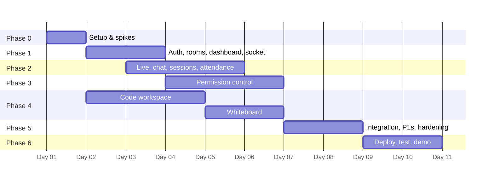

# Implementation Plan — LinkUp MVP (10 working days)

Team: 4 developers working in parallel tracks. Scope is frozen per [scope-and-decisions.md](./scope-and-decisions.md); only **P0** items are on the critical path. P1 items are picked up only after the Day 6 checkpoint is green.

---

## 1. Tracks & owners

Assign one person per track on Day 1 and write their names in the table.

| Track | Owner | Owns |
|-------|-------|------|
| **A — Backend & data** | _______ | Monorepo, Supabase, migrations, Express skeleton, auth middleware, rooms/members/sessions routes, `permissionService`, attendance queries, API tests |
| **B — Real-time & media** | _______ | Socket.IO infra (auth, rooms, presence, in-memory state), LiveKit integration (tokens, Live tab, screen share, server-side permission enforcement), attendance presence logic, reconnects |
| **C — Frontend shell & chat** | _______ | Vite/Tailwind/Router setup, auth pages, dashboard, room layout, chat (end-to-end), participants and permission panel UI, toasts, attendance page, UI polish |
| **D — Workspace tools** | _______ | Piston infra, `/execute`, code tab (Monaco + pen sync + run), whiteboard (Excalidraw sync), playground, deployment scripts |

Track A is the "contract keeper": it reviews any change to `shared/` and `api-contract.md`.

## 2. Timeline

| Day | A — Backend | B — Real-time/media | C — Frontend/chat | D — Workspace | Checkpoint |
|-----|-------------|---------------------|-------------------|---------------|------------|
| 1 | Repo, Supabase, migrations, `/me` | LiveKit spike (2 tabs + revoke test) | Vite shell, login/signup | Piston up, Monaco/Excalidraw spike | **C0:** all spikes green |
| 2 | Rooms + members API | Socket auth, `room:join`, presence | Dashboard, create/join | `/runtimes`, `/execute`, playground | |
| 3 | Sessions, LiveKit token, remove member | Live tab (video + screen) | Room layout, chat end-to-end | Code tab: pen sync | **C1:** room → call → chat |
| 4 | `permissionService` + PATCH | Attendance + perm reconcile on join | Participants panel + `perm:changed` UI | Run in room, output panel | |
| 5 | Attendance API, kick flow | Session end, reconnect banners | Attendance page, empty/error states | Whiteboard sync | **C2:** permissions on media |
| 6 | Guard tests, `canCode`/`canWhiteboard` revocation paths | Raise hand, mute all (P1) | Polish pass | Whiteboard polish, pen request (P1) | **C3:** all P0 features in |
| 7 | Integration & bug fixing (everyone), CSV export (P1) | | | | |
| 8 | Hardening, security checklist, **feature freeze at 6 pm** | | | | **C4:** freeze |
| 9 | Deploy (D leads; A, B support), seed demo data, test on 2 laptops | | | | **C5:** live on HTTPS |
| 10 | Test matrix, bug bash, demo rehearsal ×2, backup video, setup README | | | | **Demo** |

**If a checkpoint fails:** cut P1 items first. Next, cut the whiteboard down to host-only drawing, with no student edit permission. **Never cut the permission panel**, because it is the product.

---

## 3. Phase checklists

Tags: `[A]` `[B]` `[C]` `[D]` = owner track. `(P1)` = only if time allows.

### Phase 0 — Setup & spikes (Day 1)

**Goal:** everyone can run the app locally, and the three risky integrations are proven.

- [ ] `[A]` Create the GitHub repo with npm workspaces `client/`, `server/`, `shared/`. Add ESLint, Prettier, `tsconfig` base, `.editorconfig`, and `.env.example` files
- [ ] `[A]` Set branch protection on `main`: PR plus 1 review, plus a CI job running `lint` and `typecheck` (GitHub Actions)
- [ ] `[A]` Create a Supabase project. Disable email confirmation for dev, for faster testing
- [ ] `[A]` Apply `0001_init.sql` and `0002_rpc.sql` ([database.md](./database.md)). Verify that the signup trigger creates `profiles`
- [ ] `[A]` Express skeleton: `env.ts` (zod), `helmet`, CORS, error middleware, `/health`, `requireAuth`, `GET /me`
- [ ] `[B]` Create a LiveKit Cloud project and record its free-tier limits in `scope-and-decisions.md`
- [ ] `[B]` **Spike:** a hard-coded token script plus a minimal React page using `@livekit/components-react`, with 2 browser profiles seeing and hearing each other
- [ ] `[B]` **Spike:** call `updateParticipant` to remove `microphone` from `canPublishSources` while the mic is live. Record whether the track stops server-side
- [ ] `[C]` Vite + React + TS + Tailwind + React Router + TanStack Query + Zustand
- [ ] `[C]` `lib/supabase.ts`, `AuthProvider`, `ProtectedRoute`, and Login/Signup pages (sending `full_name` and `role` in `options.data`)
- [ ] `[D]` Run Piston on a Linux host/VPS (`docker run --privileged -p 2000:2000 ghcr.io/engineer-man/piston`). Install python, node, gcc (C++) and java. Check with a `curl` call to `/api/v2/execute`
- [ ] `[D]` **Spike:** render Monaco and Excalidraw on a scratch page. Confirm the Excalidraw CSS import works with Vite
- [ ] `[ALL]` Agree on the `shared/` type names from [api-contract.md](./api-contract.md) §2 and commit them

**Exit (C0):** `npm run dev` starts client and server, a user can sign up and log in, `/me` returns the profile, the LiveKit 2-tab call works, Piston runs `print(1)`, and the revoke-spike result is written down.

### Phase 1 — Foundation (Days 2–3)

**Goal:** a teacher creates a room, a student joins with a code, and both see the room page with live presence.

Backend
- [ ] `[A]` `validate(zodSchema)` middleware, `asyncHandler`, `HttpError`, and the error format from the contract
- [ ] `[A]` `GET /rooms` (via `my_rooms` RPC), `POST /rooms` (🎓, `create_room` RPC + join-code retry), `POST /rooms/join` (`join_room` RPC), `GET /rooms/:id`, `GET /rooms/:id/members`
- [ ] `[A]` `requireMember`, `requireHost` and `requireTeacher` middleware
- [ ] `[A]` 60 s token-verification cache
- [ ] `[B]` Socket.IO server attached to the same HTTP server, with auth middleware using the same `verifyToken`
- [ ] `[B]` `realtime/state.ts` (presence map) and the `room:join` handler: membership check, `socket.join('room:<id>')`, `RoomSnapshot` ack (code/board from DB), and `presence:update` broadcast
- [ ] `[B]` Disconnect handler that updates presence
- [ ] `[B]` Export an `io` singleton, so services can emit from REST handlers
- [ ] `[B]` `member:joined` emitted from `POST /rooms/join` (when the user is new)

Frontend
- [ ] `[C]` `lib/api.ts` fetch wrapper (adds the Bearer token and maps the error shape) and `lib/socket.ts` (with the `auth` callback)
- [ ] `[C]` Dashboard: room cards (name, host, members, my role), Create-room modal (name, description, 5 default-permission toggles), Join-with-code input, copy-code button, empty states
- [ ] `[C]` `RoomPage` layout: header, tabs (Live · Whiteboard · Code), sidebar (Chat · People), all wired to `useRoomSocket(roomId)`, which loads the snapshot into `roomStore`
- [ ] `[C]` People tab (read-only for now): members with online dot and role badge

**Exit:** two browsers (teacher, student) can create and join a room, and the student appears online on the teacher's People tab within 1 s.

### Phase 2 — Live classroom (Days 3–5)

**Goal:** a real class call with video, screen share and chat, plus attendance taken automatically.

Sessions & media
- [ ] `[A]` `POST /rooms/:id/sessions` (409 if active), `POST …/end`, `GET /rooms/:id/sessions`
- [ ] `[A]` `lib/livekit.ts`: `mintToken()` (grants from flags, per [architecture.md](./architecture.md) §5.2), plus `RoomServiceClient` wrappers: `updatePermissions`, `muteTrack`, `removeParticipant`, `deleteRoom`
- [ ] `[A]` `POST /rooms/:id/livekit-token`
- [ ] `[A]` Session end flow: set `ended_at`, `close_session_attendance`, `deleteRoom`, emit `session:ended`
- [ ] `[B]` Live tab: "Waiting for host" state, a Join button, `<LiveKitRoom>` with grid layout and a custom control bar (mic/cam/screen/leave)
- [ ] `[B]` Screen share shown as the focused tile, with a participant strip below
- [ ] `[B]` Keep the LiveKit connection alive while switching tabs: mount the `LiveKitRoom` at `RoomPage` level, with only the video UI inside the Live tab
- [ ] `[B]` Handle `session:started` and `session:ended` (auto-disconnect and show "Session ended")
- [ ] `[B]` "Reconnecting…" banner driven by LiveKit and socket connection state

Chat (Track C, end-to-end)
- [ ] `[C]` Server: `chat:send` handler (zod, membership, attach active `session_id`, insert, emit `chat:new` with `clientId`) and `GET /rooms/:id/messages` with cursor pagination
- [ ] `[C]` Client: ChatPanel with optimistic send, dedupe by `clientId`, auto-scroll, "load older" on scroll-top, teacher badge and time
- [ ] `[C]` Plain-text rendering plus a linkify helper (no HTML)

Attendance
- [x] `[B]` `live:joined` / `live:left` / disconnect handlers: per-user `liveSockets` set, 15 s grace timer, insert-or-reuse open record (partial unique index)
- [x] `[B]` Mark `inLive` in presence
- [ ] `[B]` Server boot recovery: close open attendance for sessions that have ended
- [ ] `[A]` `GET /rooms/:id/sessions/:sid/attendance` (via `attendance_summary` RPC)
- [ ] `[C]` Attendance page: session picker and table

**Exit (C1, end of Day 3, for call + chat):** teacher starts a session, 3 browser profiles join the call, the teacher shares a screen, and chat messages persist across reload.
**Exit (Day 5, for attendance):** a refresh doesn't duplicate attendance, ending the session closes every record, and the host sees correct minutes.

### Phase 3 — Permission control (Days 4–6) — the core

**Goal:** the teacher controls every student's mic, camera, screen, whiteboard and code access live, and the server enforces it.

- [ ] `[A]` `permissionService.update(roomId, userId, patch, actorId)`:
  - [ ] Reject a host target
  - [ ] Run the DB update and return the new flags
  - [ ] If the user is live: call LiveKit `updatePermissions` with the new `canPublishSources`, and `muteTrack` for each revoked live track
  - [x] If `canCode` was revoked and the user holds the pen: `codeService.setPen(roomId, hostId)` and emit `code:pen`
  - [ ] Emit `perm:changed` to the room
- [ ] `[A]` `PATCH /rooms/:id/members/:uid/permissions`
- [ ] `[A]` `DELETE /rooms/:id/members/:uid`: kick flow (LiveKit remove, close attendance, `room:kicked`, sockets leave, `member:removed`)
- [ ] `[B]` On `live:joined`, re-apply current DB flags with `updatePermissions`. This covers a permission change between token mint and connect
- [ ] `[B]` Socket guards: re-check flags from cache on every `wb:update` / `code:update` / `code:pen`, and keep the cache updated on `perm:changed`
- [ ] `[C]` Participants panel (host view): 5 toggles per participant, optimistic update with rollback on error, "Remove" with confirm, host row locked
- [ ] `[C]` `perm:changed` client handler ([api-contract.md](./api-contract.md) §5): store update, turn off local tracks, toast message
- [ ] `[C]` Disabled controls with tooltips ("Your teacher hasn't allowed screen sharing")
- [ ] `[C]` `room:kicked`: redirect to the dashboard with a toast
- [ ] `[A]` API tests (vitest + supertest) for the guard matrix: non-member gets 403, participant calling a host route gets 403, host target gets 403, unauthenticated gets 401
- [x] `(P1)` `[B]` Raise hand: `hand:raise` / `hand:changed`, a ✋ in the People list, and a "Grant mic" one-click action for the host
- [ ] `(P1)` `[A]` + `[C]` `POST /rooms/:id/permissions/bulk` and a "Mute all" button

**Exit (C2/C3):**
- [ ] Revoking mic/camera/screen stops the live track for all viewers in under 1 s
- [ ] A browser-console attempt to re-publish after revocation **fails**, because LiveKit rejects it
- [ ] A crafted `wb:update` from a user without permission is rejected with an `error` event, and other boards don't change
- [ ] Permissions survive leave and rejoin

### Phase 4 — Interactive workspace (Days 2–6, Track D)

**Goal:** a shared code editor with teacher-controlled edit rights that runs code, plus a shared whiteboard.

Code execution
- [ ] `[D]` `lib/piston.ts`: load runtimes at boot, map language to version, `execute()` with `run_timeout: 3000`, `compile_timeout: 10000`, memory limit, and output truncation
- [ ] `[D]` `GET /runtimes`, and `POST /execute` with zod, a 64 KB limit and `express-rate-limit` (10/min keyed by user id)
- [ ] `[D]` Map Piston being unreachable to `502 EXECUTION_UNAVAILABLE`
- [ ] `(P1)` `[D]` `/playground` page: private editor, language select, stdin, Run, output

Code tab
- [ ] `[D]` `codeService`: cache, `setPen`, `applyUpdate` (holder check, `rev++`), debounced persist (3 s), and flush when the last member leaves
- [ ] `[D]` Socket handlers: `code:update` (holder only) and `code:pen` (host only; target must be host or have `canCode`)
- [ ] `[D]` Monaco tab: `readOnly` unless holder, 150 ms debounced emit, apply incoming `code:state` while keeping the viewer's scroll, header showing "✏️ <name> is editing", host buttons "Give pen ▾" and "Take back"
- [ ] `[D]` Run button (holder or host) with stdin box and a shared output panel driven by `code:run-started` / `code:run-result`: spinner, stdout, stderr in red, exit code, time, and a timeout message
- [ ] `[D]` Default starter snippet per language
- [x] `(P1)` `[D]` "Request edit" → `code:pen-requested` badge on the host's header

Whiteboard
- [x] `[D]` `boardService`: in-memory element map, merge by version (tie → lower `versionNonce`), debounced persist (5 s), flush on last leave
- [x] `[D]` `wb:update` handler: permission check, merge, broadcast to the others
- [x] `[D]` Whiteboard tab: `<Excalidraw viewModeEnabled={!canEdit}>`, 100 ms-throttled diff broadcast of changed elements, a reconcile function, and an echo guard
- [x] `[D]` Disable the image tool, and load the snapshot on join
- [x] `[D]` React to a `perm:changed` for self by toggling view mode live
- [ ] `(P1)` `[D]` Host "Clear board" (`wb:clear` → `wb:cleared`)

**Exit:**
- [ ] Host gives the pen to a student, the student types, and 2 viewers see it live within 300 ms
- [ ] The student runs Python and everyone sees the output
- [ ] An infinite loop gets a 3 s timeout message
- [x] Whiteboard: a permitted student draws and others see it; a non-permitted student cannot draw
- [ ] The board and the code survive a reload

### Phase 5 — Integration, P1s & hardening (Days 7–8)

- [ ] `[ALL]` Full scenario run with 1 teacher and 3 students (separate browser profiles or machines). Log every bug as a GitHub issue labelled `mvp-bug`
- [ ] `[ALL]` Fix all `mvp-bug` issues with severity ≥ major
- [ ] `[B]` Reconnect tests: kill Wi-Fi for 10 s and for 30 s. Expected: one attendance record for 10 s, two records for 30 s; chat, code and board resync from the `room:join` snapshot on reconnect
- [ ] `[A]` Server restart test: data persists, open attendance is recovered, and clients reconnect
- [ ] `[A]` Run through the security checklist ([architecture.md](./architecture.md) §10)
- [ ] `[D]` SIGTERM handler flushes the code and board caches
- [ ] `[C]` UI polish: session timer in the header, Live badge on the dashboard, loading skeletons, consistent toasts, a minimum viewport of 1280×720 checked
- [ ] `(P1)` `[A]` Attendance CSV export
- [ ] `(P1)` `[C]` Profile name edit
- [ ] **Feature freeze at 6 pm on Day 8.** After that, only bug fixes

### Phase 6 — Deploy, test & demo (Days 9–10)

Deploy (Day 9)
- [ ] `[D]` VPS: Docker, `docker-compose.prod.yml` (server, piston with `privileged: true`, caddy), a domain or subdomain with DNS pointed, and Caddy auto-TLS
- [ ] `[D]` Piston is reachable only on the internal Docker network
- [ ] `[C]` Client on Vercel or Netlify with production env vars, and the SPA fallback rewrite to `index.html`
- [ ] `[A]` Production Supabase settings: Site URL and redirect URLs, plus the CORS `CLIENT_ORIGIN`
- [ ] `[B]` Test the call across 2 laptops on different networks, one of them on a mobile hotspot (TURN path)
- [ ] `[A]` Seed demo data: teacher `demo.teacher@…`, students ×3, a room "DSA Batch A" with a code sample and a whiteboard sketch

Test & demo (Day 10)
- [ ] `[ALL]` Run the test matrix (§5) on production. Every P0 row must pass
- [ ] `[ALL]` Rehearse the demo script (§6) twice, with a timer
- [ ] `[B]` Record a backup demo video, in case the venue network fails
- [ ] `[C]` Write `README.md` (root) with setup steps, env vars and scripts
- [ ] `[A]` Tag the release `v0.1.0-mvp`

---

## 4. Ways of working

| Practice | Rule |
|----------|------|
| Stand-up | 15 min daily: yesterday, today, blockers. Update the checklist in this file |
| Branches | `feat/<track>-<short-name>`, e.g. `feat/b-livekit-token` |
| PRs | ≤ 400 lines changed, 1 reviewer, green CI. Merge to `main` daily, no long-lived branches |
| Contract changes | Any change to `shared/` or `api-contract.md` needs Track A to review it |
| Local multi-user testing | Chrome profiles (Teacher, Student1, Student2) + one Edge window; LiveKit works on `localhost` |
| Secrets | Shared password manager only. Never paste keys into Slack/WhatsApp or commit them |

**Definition of Done (per checklist item):** merged to `main`, typecheck and lint pass, tested in 2 browsers, errors are handled with user-facing messages, and the checklist box is ticked.

**MVP Definition of Done:** every P0 row in the §5 test matrix passes on the deployed HTTPS build with 1 teacher + 3 students, and the demo script runs end-to-end in under 8 minutes without a restart.

## 5. Test matrix (P0)

| # | Scenario | Expected | ✔ |
|---|----------|----------|---|
| T1 | Sign up as teacher and as student; log out and back in | Profiles have correct roles; session persists across reload | ☐ |
| T2 | Student tries to create a room (UI hidden, then a direct API call) | 403 `TEACHER_ONLY` | ☐ |
| T3 | Join with a wrong code, a right code, and the right code twice | Error; joined; idempotent | ☐ |
| T4 | Non-member opens `/rooms/:id` or emits `room:join` | 403 / error ack, redirected | ☐ |
| T5 | Start session; 3 students join live; host shares screen | All see video and the screen tile | ☐ |
| T6 | Second "Start session" while one is active | 409 `SESSION_ACTIVE` | ☐ |
| T7 | Chat: send, reload, scroll for history | Message order and history are correct | ☐ |
| T8 | Toggle mic **on** for S1; S1 speaks; toggle **off** | S1's audio stops for everyone in < 1 s; S1 sees a toast | ☐ |
| T9 | After T8, S1 calls `room.localParticipant.setMicrophoneEnabled(true)` in the console | Publish rejected; nobody hears S1 | ☐ |
| T10 | Revoke screen share while S2 is sharing | Share stops for everyone | ☐ |
| T11 | Give the pen to S1 (has `canCode`); S1 types; S2 views | Live sync; S2 is read-only | ☐ |
| T12 | Revoke `canCode` from S1 while S1 holds the pen | Pen returns to host; S1 becomes read-only | ☐ |
| T13 | Run Python, JS, C++ and Java hello-world, plus an infinite loop | Outputs shown to all; 3 s timeout message | ☐ |
| T14 | 11 runs in 1 min | 11th returns 429 with a friendly message | ☐ |
| T15 | Whiteboard: S1 without permission tries to draw; grant; S1 draws | View-only, then editable live; others see the drawing | ☐ |
| T16 | Crafted `wb:update` / `code:update` from an unpermitted socket | `error` event; no change for others | ☐ |
| T17 | S2 refreshes during a session; S3 goes offline for 30 s | S2 has 1 attendance record; S3 has 2 | ☐ |
| T18 | End session | Everyone exits the call; attendance closed; summary correct | ☐ |
| T19 | Remove S3 from the room | S3 is kicked from the call and room, redirected, and can't rejoin without the code | ☐ |
| T20 | Reload after the session: code, board and chat | All restored | ☐ |

## 6. Demo script (~7 minutes)

1. **The problem (30 s):** "Teachers juggle Meet, WhatsApp, Replit and Jamboard, and none of them share permissions."
2. **Create & join (1 min):** the teacher creates "DSA Batch A" and shares the code; two students join from another laptop or phone.
3. **Live class (1 min):** start the session, video tiles appear, the teacher shares a screen, a student says hi in chat.
4. **Control (1.5 min):** ✋ a student raises a hand → the teacher grants the mic → the student speaks → the teacher revokes it → the audio stops instantly and the student sees a toast. *(If time allows: open the browser console and show that re-enabling fails.)*
5. **Code together (1.5 min):** the teacher writes a buggy loop, gives the pen to Priya, she fixes it, Run, and everyone sees the output. The teacher revokes Priya's code access and the pen comes back.
6. **Whiteboard (45 s):** the teacher draws an array diagram, grants Amit whiteboard access, and Amit marks the index.
7. **Attendance (30 s):** end the session and open attendance: minutes per student, with the refresh counted correctly.
8. **What's next (15 s):** assignments, polls, files, recordings. Same permission model.

## 7. After the MVP (roadmap)

| Release | Contents | Est. |
|---------|----------|------|
| v0.2 — Activities | Polls (live, socket-driven), assignments (create, submit file/text, grade), announcements | 2 weeks |
| v0.3 — Resources | File sharing (Supabase Storage + `can_files` permission), notifications centre, attendance reports | 2 weeks |
| v0.4 — Assessment | Exams/quizzes with server-side scoring, timers, results | 2–3 weeks |
| v0.5 — Recording | LiveKit Egress → storage, retention policy, per-teacher quota, playback page | 2 weeks |
| v1.0 — Scale | Redis adapter, Yjs co-editing, orgs/departments, admin role, invite-only teachers | 4+ weeks |
